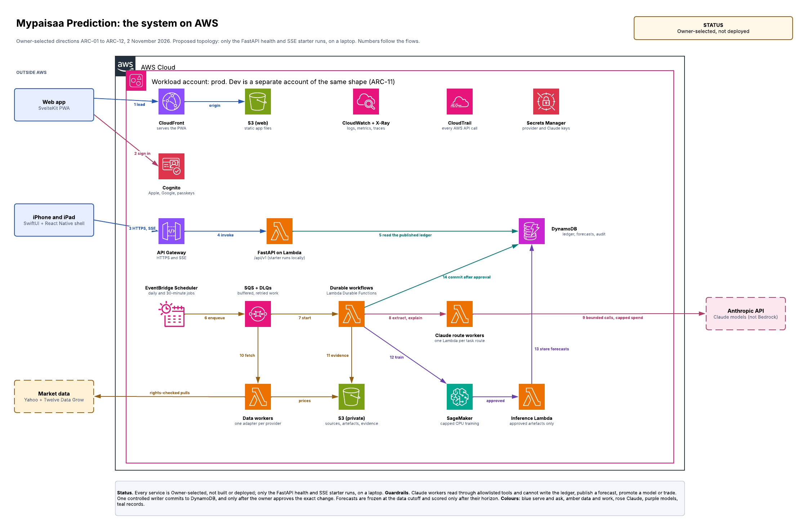
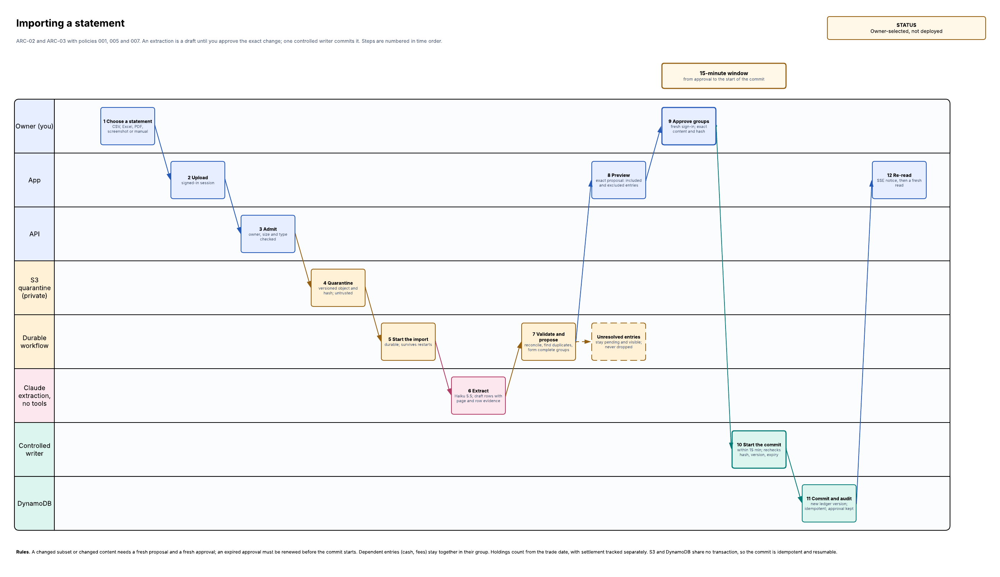
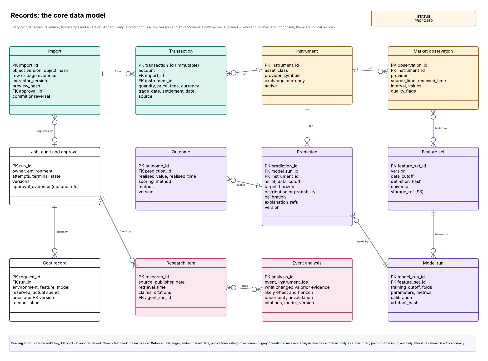
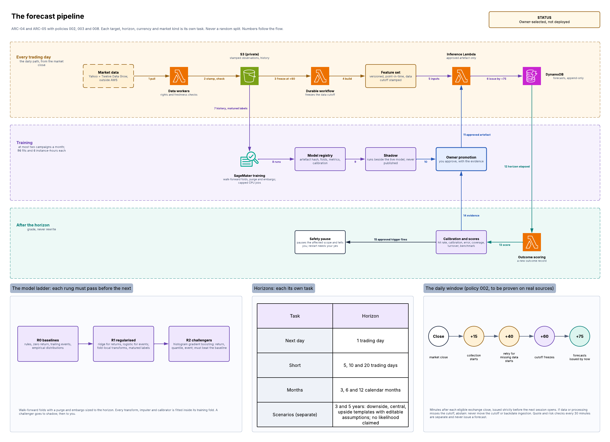
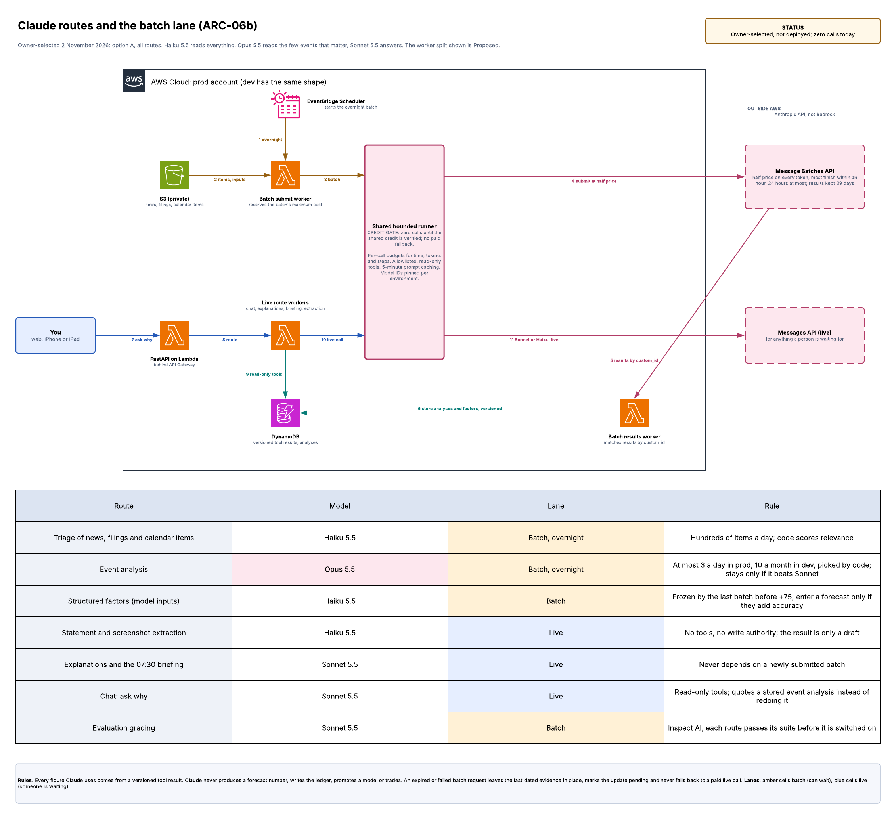
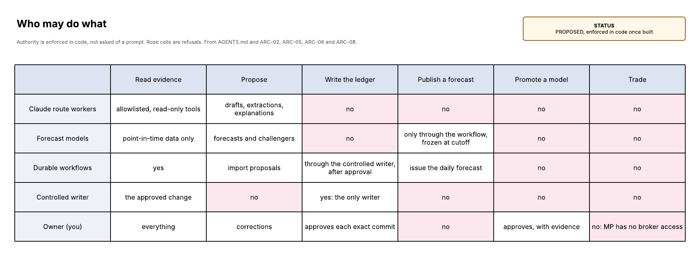
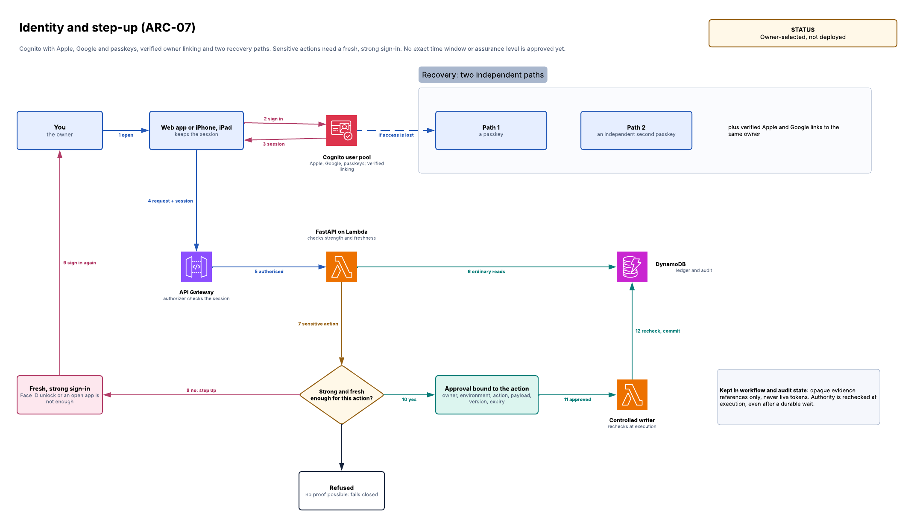
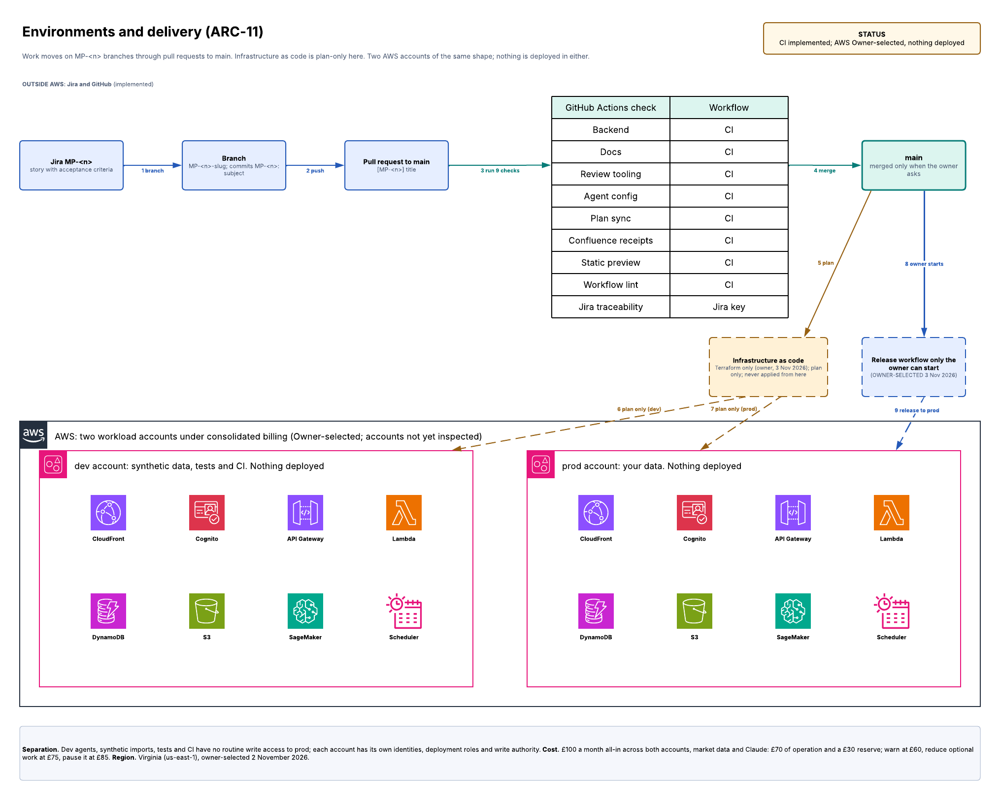

# Mypaisaa Prediction: Architecture

**Proposed architecture, from the owner-selected directions ARC-01 to ARC-12 (2 November 2026). Nothing here is deployed.**

[README](README.md) · [Tech stack](TECH-STACK.md) · [Lucid: the system on AWS](https://lucid.app/lucidchart/65667c0c-9413-4c63-863d-a60b6e67ba26/edit)

---

> [!NOTE]
> Every element on this page carries one of five status labels, and only evidence moves a label forward:
> **Proposed**, **Owner-selected**, **Approved architecture**, **Implemented**, **Deployed and verified**.
> Today the directions are Owner-selected, the detailed baseline is Proposed, and the only Implemented code is the
> FastAPI health route and sample SSE stream. Where this page and an owner decision differ, the decision wins:
> current owner instructions, then the [policy answers](docs/planning/foundation-policy-discussion-2026-11-02.md),
> then the [selected directions](docs/planning/ma-reconciliation-2026-11-02/direction-summary.md), then the drafts.

## Contents

1. [The four rules](#1-the-four-rules)
2. [The system on AWS](#2-the-system-on-aws)
3. [Four journeys through it](#3-four-journeys-through-it)
4. [Components](#4-components)
5. [Records](#5-records)
6. [Forecasting](#6-forecasting)
7. [Claude and the agents](#7-claude-and-the-agents)
8. [API and events](#8-api-and-events)
9. [Identity, security and retention](#9-identity-security-and-retention)
10. [Operations and cost](#10-operations-and-cost)
11. [Clients](#11-clients)
12. [The twelve directions](#12-the-twelve-directions)
13. [What is still open](#13-what-is-still-open)
14. [Diagram sources](#14-diagram-sources)

## 1. The four rules

1. **Numbers come from code and models, words from Claude.** The ledger, returns, XIRR and risk are Python. Forecasts
   are numerical models. Claude extracts and explains, and every figure it uses comes from a versioned tool result.
2. **Every forecast is frozen, then graded.** Append-only records: a correction is a new version, an outcome is a new
   record, and the original forecast is never rewritten.
3. **Nothing changes without the owner.** One controlled writer commits to the ledger, and only an exact change the
   owner approved. A challenger model is promoted only by the owner, with its evidence.
4. **It cannot trade.** No broker credentials, no order path, no personalised advice.

## 2. The system on AWS

Lucid page 1 of 9, native AWS 2024 shapes. [Open it in Lucid](https://lucid.app/lucidchart/65667c0c-9413-4c63-863d-a60b6e67ba26/edit) · [manifest](docs/diagrams/mp-architecture-2026-11-02/manifest.json) · [the script that drew it](docs/diagrams/mp-architecture-2026-11-02/lucid_spec.py).

The shape is serverless and small on purpose: nothing runs when nobody is asking, which is how a £100 all-in month
stays possible. Two AWS accounts, dev and prod, have the same shape (ARC-11). There is no NAT Gateway, load balancer,
RDS or always-on endpoint; any of those needs a costed ADR first.

| Layer | Services | Status |
| --- | --- | --- |
| Doors | SvelteKit PWA served by CloudFront from S3; SwiftUI app in a React Native shell | Owner-selected |
| Edge and identity | API Gateway (HTTPS and SSE), Cognito with Apple, Google and passkeys | Owner-selected |
| API | FastAPI on ordinary Lambda, `/api/v1` | Starter implemented locally; Lambda Owner-selected |
| Work | EventBridge Scheduler, SQS with dead-letter queues, Lambda Durable Functions in Python | Owner-selected |
| Claude | One Lambda worker per task route, calling the Anthropic API through the Python client SDK | Owner-selected |
| Models | SageMaker CPU training jobs, capped; approved artefacts served from a Lambda | Owner-selected |
| Records | DynamoDB (ledger, forecasts, audit) and private, encrypted S3 (sources, artefacts, evidence) | Owner-selected |
| Operations | CloudWatch and X-Ray, CloudTrail, Secrets Manager | Proposed |
| Outside AWS | Anthropic API; Yahoo Finance and Twelve Data Grow | Owner-selected |

## 3. Four journeys through it

One system, four journeys. An explainer, not live traffic. <a href="docs/motion/system-flow.png">Still image</a>.

The numbers in brackets match the numbered flows on the Lucid page.

Lucid page 5. Importing a statement, lane by lane.

| Journey | Path | What holds |
| --- | --- | --- |
| **Open the app** | Door → CloudFront and S3 (1) → Cognito sign-in (2) → API Gateway (3) → FastAPI (4) → DynamoDB (5) | Reads pin one complete published version of the ledger and forecasts. SSE carries short notices only; the client then re-reads durable state. |
| **Import a statement** | Door → API → private S3 → durable workflow (7) → Claude extraction with no tools (8) → proposal → owner approval → controlled writer (14) | The file is quarantined first. An extraction is a draft until the owner approves the exact change. S3 and DynamoDB share no transaction, so a commit is idempotent and resumable. |
| **The daily forecast** | Scheduler (6) → SQS → data workers (10) → market data → S3 → workflow → inference Lambda → DynamoDB (13) | Prices are stamped and checked for rights and freshness. Inputs freeze at the cutoff. Only approved artefacts run. |
| **Ask why** | Door → API → Claude route worker → Anthropic API (9) → read-only tools over DynamoDB → answer | Every figure in the answer comes from a tool result. Source text is data, never an instruction. |

The daily window, chosen 2 November 2026 and still to be proven against real sources, runs from the market close:
collection starts at +15 minutes, a retry for missing data starts at +40, the cutoff freezes at +60, and forecasts are issued by +75. Quote and risk checks every
30 minutes are a separate, lighter path and never produce a formal forecast.

## 4. Components

| Component | Job | Technology | Status |
| --- | --- | --- | --- |
| API | Authenticated commands, read models, bounded SSE, job admission | FastAPI on Lambda, Pydantic schemas at every boundary | Starter implemented |
| Ledger | Transactions, holdings, cash, reconciliation, XIRR | DynamoDB through one controlled write service | Owner-selected; atomicity proof pending |
| Imports | CSV, Excel, PDF, screenshot and manual input to an approved commit | S3 quarantine, durable workflow, tool-free extraction, owner approval | Owner-selected |
| Market data | Provider adapters, symbol mapping, quality flags, quotas | Data worker Lambdas, Yahoo and Twelve Data | Owner-selected; rights per listing unverified |
| Forecast engine | Features, walk-forward training, calibration, scoring | Python with scikit-learn-style pipelines, SageMaker CPU jobs | Owner-selected |
| Prediction registry | Frozen forecasts, model runs, cutoffs, outcomes, approvals | Append-only DynamoDB records with S3 artefacts | Proposed |
| Research and chat | Cited research, extraction, explanations, chat | Claude route workers with a shared bounded runner | Owner-selected |
| Evaluation | Agent scenarios, transcripts, replays, scored reports | Inspect AI and deterministic checks | Owner-selected |
| Admin | Files, audit, runs, models, approvals, costs, incidents, identity | Full journeys specified before the first build (ARC-08) | Owner-selected |

## 5. Records

Every record carries its source, its timestamps and a version. Market observations store the provider, the symbol
mapping, the source time, the ingestion time and quality flags, and are validated before they are kept.

Lucid page 8. The data model. PROPOSED.

| Record | Holds |
| --- | --- |
| Instrument | Internal ID, asset class, provider symbols, exchange, currency, active state |
| Market observation | Instrument, provider, source and received times, interval, values, quality flags |
| Transaction | Immutable ID, account and import batch, instrument, quantity, price, fees, currency, dates, source |
| Import | Object version and hash, row or page evidence, extractor version, preview hash, approval, commit or reversal |
| Feature set | Version, data cutoff, definition hash, universe, storage reference |
| Model run | Training cutoff, feature set, folds, parameters, metrics, calibration, artefact hash |
| Prediction | Model run, instrument, as-of, data cutoff, target, horizon, distribution or probability, calibration, explanation references, version |
| Outcome | Prediction, realised value and time, scoring method, metrics, version |
| Research item | Source, publisher and date, retrieval time, claims, citations, agent run |
| Job, audit and approval | Owner and environment, run IDs, attempts, terminal state, versions, approval evidence |
| Cost record | Request, environment, feature, model, reserved and actual spend, price and FX version, reconciliation |

## 6. Forecasting

Lucid page 3. From data to a scored outcome.

**What is forecast.** Each target, horizon, currency and market kind is its own task with its own eligibility:
the next day, 5, 10 and 20 trading days, and 3, 6 and 12 calendar months. A month anniversary that is not a trading
day rolls back to the preceding valid session. Separate 3 and 5 year scenarios use templates with editable
assumptions and claim no likelihood.

**How models earn trust.** Never a random split. Walk-forward folds with a purge and embargo sized to the horizon,
every transform, imputer and calibrator fitted inside its training fold, and labels used only once they have matured.

| Rung | Models | To pass |
| --- | --- | --- |
| R0 baselines | Rules, zero return, trailing events, empirical distributions | Correct semantics, chronological comparison |
| R1 regularised | Ridge for returns, logistic for events | Fold-local transforms, purging, matured labels, justified calibration |
| R2 challengers | Histogram gradient-boosted return, quantile and event models | Beat the baseline with uncertainty and coverage, then shadow, then owner promotion |

Scores report hit rate alongside calibration, error, interval coverage, turnover and the benchmark. Ranked actions
combine growth, protection and opportunity at 35, 40 and 25, and only when all three are eligible; a missing score is
neither zero nor a reason to reweight. Training is capped at two campaigns a month across dev and prod, each at most
96 fits and six training-instance hours.

Self-learning means this loop, with the owner as the gate. <a href="docs/motion/learning-loop.png">Still image</a>.

## 7. Claude and the agents

Lucid page 4. Which route runs which model, live or batched.

Claude runs on Anthropic, called through the official Python client SDK in an explicit, server-controlled loop: not
Bedrock, and not the Agent SDK. Each task route (extraction, research, structured factors, explanations and
briefings, chat) is its own Lambda worker sharing one bounded runner, so each keeps its own context, tools and
budget.

**Models per route (ARC-06b, Owner-selected 2 November 2026):** Haiku 5.5 triages every news, filing and calendar
item and prepares model inputs; Opus 5.5 analyses at most three material events a day; Sonnet 5.5 answers chat, writes
explanations and the 07:30 briefing, and grades evaluations. Triage, event analysis, model inputs and eval grading run
overnight through the Message Batches API at half price; anything a person waits for runs live. Each route must pass
its evaluation before it is switched on, and Opus keeps event analysis only if it beats Sonnet there.
[The card](docs/planning/claude-models-and-batching-2026-11-02.md) has the costs and rules.

Lucid page 2. Authority is enforced in code, not asked of a prompt.

- Tools are allowlisted and read-only by default, with typed schemas and per-call budgets for time, tokens and steps.
- Files, pages and tool output are untrusted data. Extraction runs with no tools and no write authority.
- Agents cannot write the ledger, publish or change a forecast, promote a model, read secrets or trade.
- Inspect AI organises the evaluations: deterministic checks and replays first, budgeted live checks and
  human-calibrated judges later. Runtime guardrails and numerical forecast validation are separate evidence.

## 8. API and events

All routes live under `/api/v1`. Responses are Pydantic schemas, never storage records.

| Route family | Purpose |
| --- | --- |
| `health` | Liveness and non-sensitive dependency status (implemented) |
| `instruments`, `prices` | The instrument catalogue, price history with freshness |
| `portfolio`, `imports` | Preview, approval, commit and reversal; holdings and reconciliation |
| `predictions` | Current and past forecasts, outcomes, model provenance |
| `research`, `conversations`, `jobs` | Cited briefings, chat, task state and confirmations |
| `costs`, `audit`, `settings` | Spend by environment, activity, protected controls |
| `stream` | Authenticated server-sent events (a sample stream is implemented) |

SSE is one-way and carries only an event ID, a type, a time and a resource reference: never holdings, credentials,
provider payloads or model artefacts. It sends heartbeats, resumes from the last event ID where it can, and the
client always re-reads the durable record. On AWS, response streaming needs a REST API proxy integration in stream
mode and a Lambda streaming adapter; that is still to be proven. The starter's stream has no authentication or
durable replay. Proposed (MP-36): every error response carries a code, a message, the `request_id` and the
`trace_id`.

## 9. Identity, security and retention

Lucid page 6. Sign-in, recovery and step-up.

- **Sign-in:** Cognito with Apple, Google and passkeys, verified owner linking and two independent recovery paths.
  Sensitive actions need a fresh, strong sign-in (ARC-07).
- **Approvals:** a financial approval allows 15 minutes to start the exact commit; an export link allows new
  downloads for one hour.
- **Secrets:** in Secrets Manager or the iOS Keychain only; never in git, logs, fixtures, screenshots or errors.
- **Data:** encrypted storage, private S3 origins, per-environment authority, rate limits on sign-in and expensive
  routes, CSRF protection on cookie sessions, and logs scrubbed of values and provider responses.
- **Retention:** core financial and decision records for the life of the account, subject to deletion; originals
  for a renewable 24 months; operational logs 14 days, rich traces 30 days, run summaries 90 days.

## 10. Operations and cost

Every run records its trigger, model calls, tokens, cost, tools and outcome. One trace follows a request from the door
to the model. Proposed (MP-36): that one trace covers the hops a person waits on; queued, resumed, scheduled and
batched work starts a new trace joined by business ids and span links, and Activity stays complete when a span is missing
(PL-12). The planned dashboard separates dev from prod and shows estimates, credits and reconciled billing, with
the lag stated: internal estimates live, Anthropic usage every six hours, AWS billing daily.

The ceiling is £100 a month all-in, planned as £70 of operation and a £30 reserve, warning at £60, reducing optional
work at £75 and pausing it at £85. These controls cannot stop every AWS charge instantly, so hard caps on requests,
concurrency, timeouts and retention back them. The draft numbers do not yet fit; [TECH-STACK.md](TECH-STACK.md#9-monthly-cost)
shows why.

**Proposed (MP-36):** no customer VPC by default; an optional VPC lockdown is costed on the perimeter page and decided
at PH-08. Prod approval cannot be enforced by GitHub on the current Free plan for a private repo; the route is an owner
decision (PL-11, MP-30).

Lucid page 7. Two accounts of the same shape, and the CI checks as they stood before MP-35 added Plan sync and Confluence receipts.

## 11. Clients

- **Web:** a prebuilt, static SvelteKit PWA on S3 and CloudFront. Private data and commands go through the
  authenticated FastAPI (ARC-10). Market discovery first, holdings a tap away, chat to explain.
- **Apple:** SwiftUI owns the iOS and iPadOS screens, persistence, widgets, Keychain and notifications. The React
  Native shell owns cross-platform navigation and typed bridge contracts only.
- **Both:** accessible and responsive, and never hide risk, staleness or a provider's status behind a spinner.
- **Proposed (MP-36):** WCAG 2.2 Level AA as the accessibility standard for web and Apple, pending the owner's yes.

## 12. The twelve directions

| Card | Area | Selected |
| --- | --- | --- |
| ARC-01 | Source rights and budget | Keep Yahoo and Twelve Data Grow; verify uses, investigate gaps |
| ARC-02 | Ledger and imports | DynamoDB and S3, with one controlled write service |
| ARC-03 | Durable workflows | Lambda Durable Functions in Python, not Step Functions |
| ARC-04 | ML training and serving | Selective SageMaker training, portable Lambda inference |
| ARC-05 | Experiments and calibration | Baselines first, then bounded challengers |
| ARC-06 | Claude routes | A separate Lambda worker for each task route |
| ARC-07 | Identity and step-up | Cognito with assurance and freshness checks |
| ARC-08 | Admin, audit, retention, recovery | Every admin journey specified before the first build |
| ARC-09 | Guardrails and evaluation | Inspect AI with deterministic checks |
| ARC-10 | Client rendering | Static SvelteKit PWA with authenticated FastAPI |
| ARC-11 | Environments | Separate dev and prod AWS accounts |
| ARC-12 | Documentation freeze | Architecture-area specs linked to phases and stories |
| ARC-06b | Claude models and batching | Haiku triage, Opus event analysis, Sonnet live; batch what can wait (2 November 2026) |

The [decision log](docs/planning/ma-reconciliation-2026-11-02/decision-log.md) holds each answer's exact scope.

## 13. What is still open

- **52 gaps** in the [gap register](docs/planning/ma-reconciliation-2026-11-02/gap-register.json), and 64 local story
  drafts that are not yet Jira stories.
- **Source rights (MP-10):** on published terms, Yahoo forbids automated collection and Twelve Data labels Grow
  view-only, so ARC-01's mix lacks the storage, training and monitoring rights MP needs. The options and the vendor
  questions are in the [MP-10 findings](docs/planning/source-rights-2026-11-02/README.md); ARC-01 stands until the
  owner answers.
- **Cost fit:** the £100 ceiling with Grow at $79 does not fit an invoice month; the cheaper tier is unverified.
- **Proofs:** DynamoDB ledger atomicity, durable-function replay, streaming through API Gateway, Cognito tier and
  recovery, listing rights per market, and the Region.
- **Claude:** the refusal-fallback choice, per-route chat caps, the measured event-analysis volume in the cost
  model, and the evaluation sets that qualify each route ([ARC-06b](docs/planning/claude-models-and-batching-2026-11-02.md)).
- **The sign-off** of this baseline at an exact revision (MP-20), which must come before any UX work.

## 14. Diagram sources

| Diagram | Source | Exports |
| --- | --- | --- |
| Nine pages: the system on AWS, who may do what, the forecast pipeline, Claude routes and batching, importing a statement, identity and step-up, environments and delivery, records, the road | [Lucid](https://lucid.app/lucidchart/65667c0c-9413-4c63-863d-a60b6e67ba26/edit), drawn from [`lucid_spec.py`](docs/diagrams/mp-architecture-2026-11-02/lucid_spec.py) | PNGs and the [manifest](docs/diagrams/mp-architecture-2026-11-02/manifest.json) in [`docs/diagrams/mp-architecture-2026-11-02/`](docs/diagrams/mp-architecture-2026-11-02/) |
| The animations on this page | [`docs/motion/build_motion.py`](docs/motion/build_motion.py) | GIFs and stills in [`docs/motion/`](docs/motion/) |

Exports are snapshots; an edit in Lucid reaches the repo only when it is exported again and the manifest updated.
