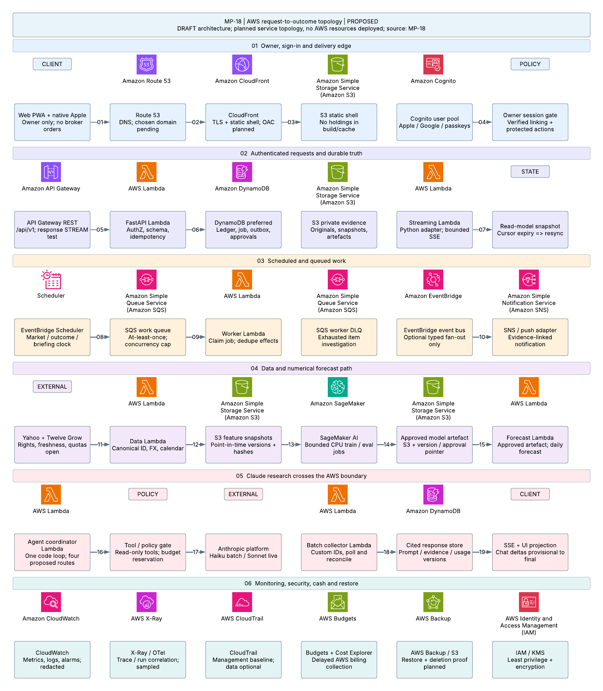
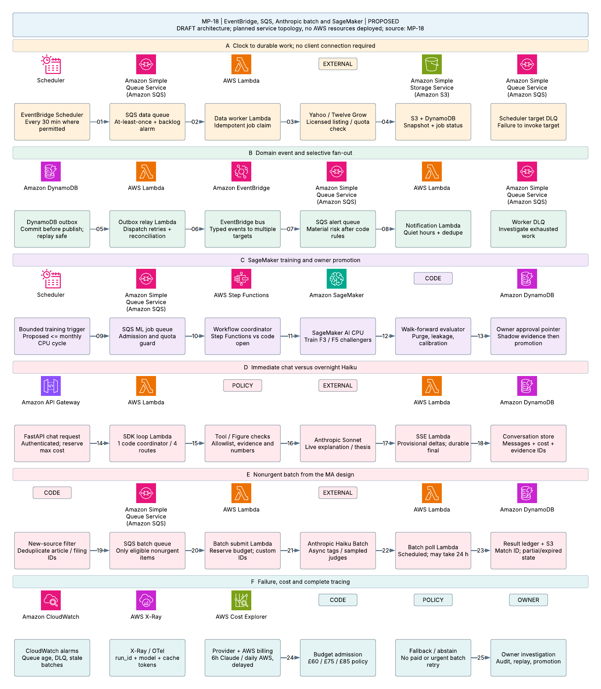
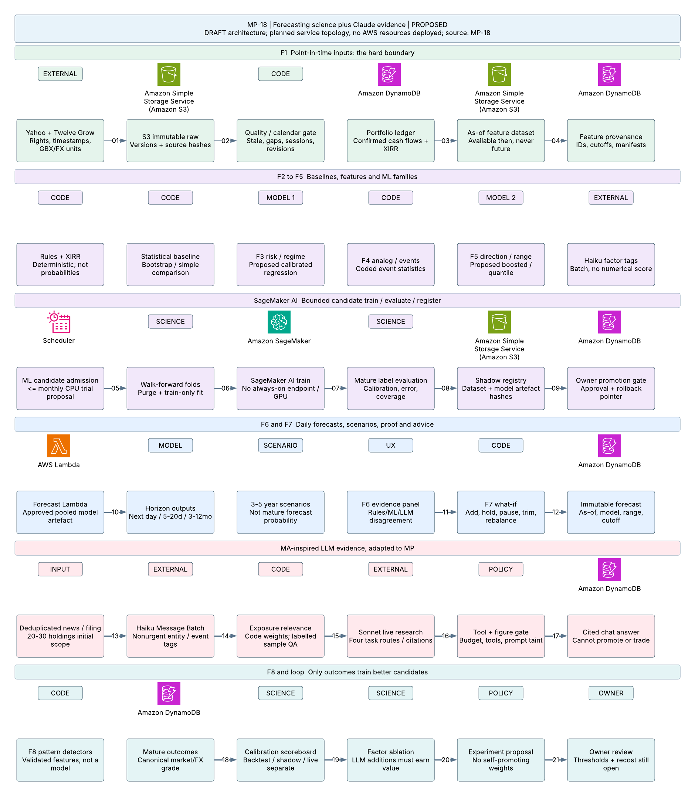
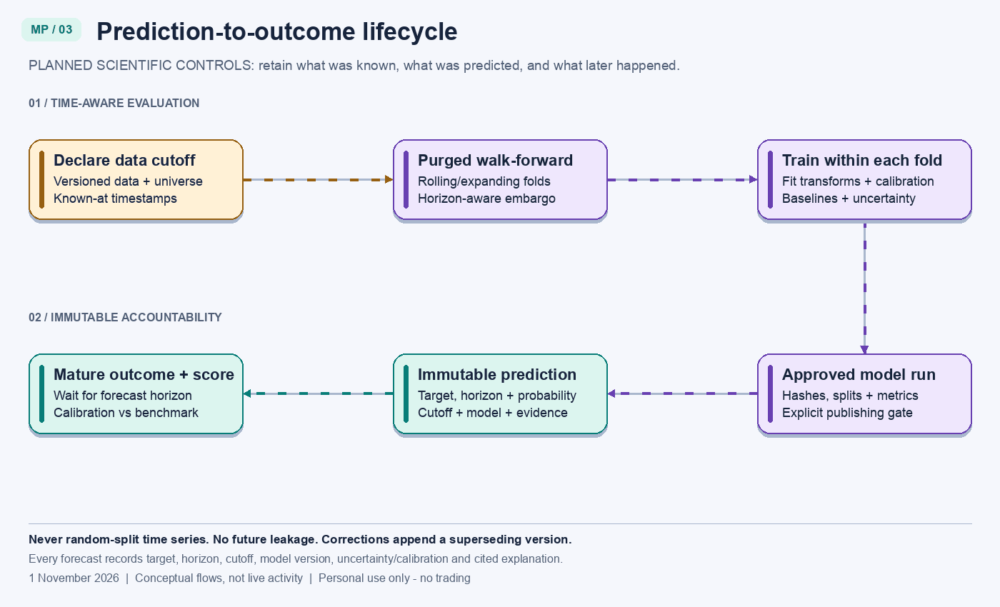

<div align="center">

<picture>
  <source media="(prefers-color-scheme: dark)" srcset="docs/readme/mark-dark.svg">
  
</picture>

# Mypaisaa Prediction

### Understand your holdings. Test the forecast. Keep the evidence.

**Private investment intelligence for shares and ETFs across the US, UK and India.**<br>
Rules and XIRR establish financial facts. ML tests numerical forecasts. Claude researches and explains the evidence. You decide what to do.

<a href="#project-status"></a>
<a href="#costs-and-operational-visibility"></a>
<a href="#what-this-project-is"></a>
<a href="https://github.com/gilipersonal/mypaisaa-prediction/actions/workflows/verify.yml"></a>

**Intended stack — product capabilities remain planned unless stated otherwise**

<a href="#tech-stack"></a>
<a href="#tech-stack"></a>
<a href="#tech-stack"></a>
<a href="#tech-stack"></a>
<a href="#tech-stack"></a>
<a href="#tech-stack"></a>
<a href="#tech-stack"></a>
<a href="#tech-stack"></a>
<a href="#tech-stack"></a>

**[Architecture](docs/architecture.md) · [Tech stack](docs/tech-stack.md) · [Foundation specifications](docs/planning/foundation-specifications-2026-11-02/README.md) · [Latest policies](docs/planning/foundation-policy-discussion-2026-11-02.md) · [Phase plans](docs/planning/ma-reconciliation-2026-11-02/phase-story-baseline.json)**

**[MP Jira](https://duttaarun2015.atlassian.net/jira/software/projects/MP/boards/167/backlog) · [MP Confluence drafts](https://duttaarun2015.atlassian.net/wiki/spaces/mypaisaapr/pages/4981720) · [Editable AWS Lucidchart](https://lucid.app/lucidchart/02218133-613a-4b78-aea4-e0dba26db386/edit)**

</div>

> [!IMPORTANT]
> **Planning is active; the complete architecture baseline is not approved.** As of 2 November 2026, the API has runnable health/sample SSE routes. Local synthetic-data tooling and a static concept/architecture site also exist. Authentication, ledger/imports, live providers, agents, ML and the web/native product apps remain planned. No AWS deployment is recorded. Architecture/contracts and the detailed phase/story baseline must be agreed before UX; complete UX approval and explicit permission precede application implementation.

## Contents

- [What this project is](#what-this-project-is)
- [Project status](#project-status)
- [Tech stack](#tech-stack)
- [Architecture at a glance](#architecture-at-a-glance)
- [Models, agents and controlled learning](#models-agents-and-controlled-learning)
- [Guardrails, evaluations and audit](#guardrails-evaluations-and-audit)
- [Costs and operational visibility](#costs-and-operational-visibility)
- [Documentation](#documentation)
- [Phase-by-phase delivery](#phase-by-phase-delivery)
- [Repository structure](#repository-structure)
- [Run the existing starter](#run-the-existing-starter)
- [Checks and contribution workflow](#checks-and-contribution-workflow)

## What this project is

Mypaisaa Prediction is a standalone investment intelligence app with its own holdings, transactions and import history. It should protect existing holdings, improve contribution/rebalancing decisions and assess growth and benchmark-relative opportunity. The intended landing experience is market/discovery first, with holdings separately accessible and chat available to explain recommendations.

**MA supplies concepts and documentation structure.** Its household scope, accounts, model IDs, budgets and permissions do not transfer here.

| Capability | Planned behaviour |
| --- | --- |
| 🌍 Coverage | Initially 20–30 shares/ETFs across US, UK and India, from holdings plus a research watchlist. Verify each listing and permitted use. Later adapters can add China, Taiwan, Hong Kong, Europe and themes such as solar/clean energy. |
| 📁 Holdings | CSV, Excel, PDFs, screenshots and manual inputs; sample-backed layouts and generic templates. Uncertain extraction stays a draft until resolved and explicitly approved. |
| 📊 Forecasts | Next day; 5/10/20 trading days; 3/6/12 calendar months. Month anniversaries roll back to a valid preceding session/valuation date. Each task requires separate qualification and mature-outcome evidence. |
| 🧭 Long-term scenarios | Separate 3/5-year downside, central and upside templates plus editable assumptions. Values need approval; “central” implies no likelihood. |
| 🔔 Monitoring | Eligible quote/risk checks every 30 minutes; configurable 07:30 Europe/London briefing; app/chat records and native/PWA push. Quiet hours 22:00–07:00 with separately approved critical exceptions. |
| 💬 Recommendations | Add/hold/pause/trim/rebalance suggestions, with reasons, uncertainty and portfolio impact. Show rules/ML/research disagreement and abstain where evidence is insufficient. |

**No trade execution:** no broker trading credentials, order submission or agent authority to transact. Output is decision support, with no promise of high accuracy or personalised investment advice. XIRR describes historical money-weighted performance; it is not a forecast.

## Project status

| State | What exists or is agreed |
| --- | --- |
| 🟢 Runnable | FastAPI health/sample SSE starter, offline synthetic fixtures/document tools and the static concept/architecture presentation. |
| 🔵 Owner-selected | Twelve architecture directions, two horizon details and twelve later policy selections. These do not approve the complete baseline, implementation or deployment. |
| 🟠 Draft | Data/financial/forecast contracts, worked examples, planned acceptance, cost scenarios, admin/control requirements and phase/story structure. |
| ⚪ Unimplemented | Authenticated financial backend, live ingestion/agents/ML, SvelteKit product app, Apple product app and production infrastructure. |

Decision precedence: **current owner instructions → [later policy receipts](docs/planning/foundation-policy-discussion-2026-11-02.md) → [selected architecture directions](docs/planning/ma-reconciliation-2026-11-02/direction-summary.md) → detailed drafts → historical references**. The policy journal awaits coordinated integration; older pending fields do not override its later selections. Merging planning documents does not approve architecture or start UX/build work.

Foundation review round 1 found five specification issues. Fixes have maker checks; independent verification remains pending because round 2 was declined. See the [review report](review/MP-20/round-1.md) and [state](review/MP-20/state.json). The later policy journal has not had independent review.

## Tech stack

| Layer | Selected technology/direction | Responsibility and actual state |
| --- | --- | --- |
| 🟦 Web | **SvelteKit 3 PWA · S3 · CloudFront** | Static adaptive app shell; private data via authenticated API. `web/` is a reserved product path, not tracked app code. The React/Vite architecture site is a documentation presentation, not the product app. |
| 🟧 Apple | **Swift / SwiftUI + React Native shell** | Native iOS/iPadOS surfaces; RN navigation/bridges. Product paths are reserved, without tracked app code; exact device/foldable support needs design and verification. |
| 🟦 API / identity | **Python FastAPI · ordinary Lambda · Cognito** | Typed API, bounded SSE, Apple/Google/passkeys and sensitive-action assurance. Only unauthenticated health/sample SSE is runnable; streaming/auth/recovery need proof. |
| 🟨 Background work | **Python Lambda Durable Functions · EventBridge Scheduler · SQS/DLQs** | Durable imports/approvals/jobs, timed triggers, buffered workers, retries and controlled replay. Durable Functions is primary; Step Functions is not selected initially. |
| 🟪 LLM routes | **Anthropic Python client SDK · Claude on Anthropic** | Separate Lambda worker per task route; shared bounded runner/policy code. No Bedrock or Claude Agent SDK runtime is selected. Exact models, batch use and tool/token budgets remain to qualify. |
| 🟦 Financial records | **DynamoDB · encrypted private S3** | One controlled writer, versioned ledger, source archive and evidence manifests. Atomicity, completeness, indexes and restore/deletion need proof. |
| 🟩 Numerical ML | **Rules/statistical baselines · regularised models · bounded boosted challengers** | CPU-first chronological validation, calibration and per-task eligibility. No training/backtest engine or live inference is implemented. |
| 🟩 ML execution | **Selective SageMaker CPU jobs · S3 artefacts · portable Lambda inference** | Capped training/evaluation and stored daily forecasts from compatible approved artefacts. No always-on endpoint by default; runtime and cost proof pending. |
| 🟨 Market data | **Yahoo Finance + Twelve Data Grow; Basic considered for dev** | Provider/listing adapters, rights/freshness checks and weighted quotas. No live connector, purchased plan or exchange entitlement is established. |
| 🟪 Evaluation | **Inspect AI + deterministic checks · pytest** | Agent scenarios/transcripts, replays and bounded later live evals. Runtime guards and numerical forecast validation remain distinct evidence tracks. |
| 🟦 Operations | **CloudWatch · tracing/OpenTelemetry · audit/cost records** | App-visible runs, incidents, AWS and Claude spend. Separate dev/prod workload accounts under consolidated billing; no account/region/network provisioning is claimed. |
| ⚙️ Delivery | **GitHub Actions · MP branches · PRs to `main`** | Five named CI checks exist. Infrastructure remains plan-only; IaC implementation choices require their own agreed scope. |

[Detailed stack and starter versions](docs/tech-stack.md) · [Interface matrix](docs/planning/layered-development-2026-11-01/tech-stack-matrix.md) · [API versus durable-work boundary](docs/planning/ma-reconciliation-2026-11-02/api-workflow-boundary.md)

## Architecture at a glance

**Authenticate → read or propose → validate and authorise → commit/publish → explain → observe and grade.**

| Journey | Integration points | Authority and evidence |
| --- | --- | --- |
| Open the app | PWA/SwiftUI → Cognito → FastAPI API Lambda → read models | Pin a complete published ledger/forecast version. SSE carries short-lived updates; authenticated reads fetch durable state. |
| Import a statement | Private S3 → quarantine/tool-free extraction → versioned proposal → owner approval → financial writer | Exact-content commit; explicitly reviewed complete groups only, unresolved entries pending. S3 and DynamoDB do not share one transaction. |
| Refresh data/risk | EventBridge Scheduler → admission → SQS → provider workers → observations → deterministic risk checks | Rights, quotas, calendars, freshness and cash/credit gates apply. Daily-only sources do not become live feeds. |
| Qualify a model | Durable Python workflow → bounded SageMaker jobs → walk-forward/calibration → evidence/artefact → shadow → owner promotion | Count every training/calibration fit. No future input leakage or automatic promotion. Compatible approved artefacts feed daily inference. |
| Ask about a recommendation | Authenticated chat → route worker → client-SDK loop → Anthropic-hosted Claude → allowed evidence tools → cited answer | Numerical facts reference versioned tools. Agents cannot commit the ledger or promote a model; untrusted sources have no policy authority. |
| Learn and operate | Mature canonical outcomes → append scores/corrections; all flows → run/audit/cost records → dashboard/alerts | Preserve original predictions. Pause only affected scopes under advance-approved triggers; restart requires owner approval. |

### Native Lucid technical views

The [deep dive](docs/architecture-deep-dive.md) explains integration/failure contracts. These native AWS exports are **1 November proposal snapshots**, preceding later refinements. They are technical references, not the final approved or deployed topology. Current selected directions above take precedence until approved visual reconciliation.

<details>
<summary><strong>🟦 View 1 — Clients, identity, Lambda and network boundaries</strong></summary>

[](https://lucid.app/lucidchart/02218133-613a-4b78-aea4-e0dba26db386/edit)

</details>

<details>
<summary><strong>🟨 View 2 — EventBridge, SQS, worker routes and batching</strong></summary>

[](https://lucid.app/lucidchart/02218133-613a-4b78-aea4-e0dba26db386/edit)

</details>

<details>
<summary><strong>🟩 View 3 — Forecasting, SageMaker, outcomes and controls</strong></summary>

[](https://lucid.app/lucidchart/02218133-613a-4b78-aea4-e0dba26db386/edit)

</details>

[Edit in Lucid](https://lucid.app/lucidchart/02218133-613a-4b78-aea4-e0dba26db386/edit) · [Export/version/hash manifest](docs/diagrams/aws-e2e-2026-11-01/manifest.json) · [Visual catalogue](docs/diagrams/README.md)

<details>
<summary><strong>▶ Optional motion — scientific lifecycle, with a static alternative</strong></summary>

The historical companion illustrates cutoff → validation → forecast → maturity → outcome. It is not live telemetry or predictive-quality evidence. GIF playback may loop; the static image avoids motion.



[Static lifecycle](docs/diagrams/prediction-lifecycle.png) · [Supporting editable Draw.io](docs/diagrams/prediction-lifecycle.drawio)

</details>

## Models, agents and controlled learning

**Numerical models and LLMs have different jobs.** Numerical models produce evaluated distributions/events. Anthropic-hosted LLMs extract, research and explain evidence. A convincing explanation does not establish forecast skill.

| Track | Proposed initial ladder | Qualification |
| --- | --- | --- |
| R0 — transparent baselines | Rules, zero-return/trailing-event and empirical distribution/risk references | Correct semantics and chronological comparison. XIRR remains a separate historical metric. |
| R1 — regularised CPU | Ridge return and logistic event models | Fold-local transforms, purging/embargo, matured labels and justified calibration. |
| R2 — bounded challengers | Histogram gradient-boosted return, quantile and event candidates | Incremental baseline improvement, uncertainty/coverage, shadow evidence and owner promotion. |
| Additional features | Regime, causal patterns, historical analogues, events/news and controlled LLM factors | Permitted point-in-time inputs and demonstrated incremental value; no unlimited search. |

Each target/horizon/currency/market-kind scope has its own eligibility. A family can produce several artefacts; no one-model-per-ticker or all-horizon monthly qualification is promised. Selected ceilings are **two campaigns/month across dev+prod; 96 fits and six training-instance hours each**, subject to stricter cost/resource admission.

Claude routes cover isolated extraction, specialist research, structured factors, explanations/briefings and holdings chat. Workers share bounded runner code but keep context/tools/budgets scoped. Nonurgent economy-model batching is a candidate optimisation; interactive chat needs a separate latency path. Exact model IDs, route count and batch/cache policies remain to be specified and evaluated, rather than copied from MA.

“Self-learning” means **record → wait for outcome → evaluate → propose challenger → qualify/shadow → seek approval**. It does not silently change live weights or rewrite forecasts. Daily formal forecasts and 30-minute quote/risk monitoring are separate. The selected daily window is +15 collection / +40 retry / +60 fixed cutoff / +75 issuance, conditional on source/processing proof.

[Model catalogue](docs/planning/foundation-specifications-2026-11-02/forecasting/model-catalogue.json) · [Qualification protocol](docs/planning/foundation-specifications-2026-11-02/forecasting/evaluation-protocol.json) · [Task/horizon catalogue](docs/planning/foundation-specifications-2026-11-02/forecasting/task-catalogue.json)

## Guardrails, evaluations and audit

These are planned control requirements, not claims of an implemented financial/agent runtime. Offline contract proofs remain distinct from product acceptance.

- **Authority in code:** typed/allowlisted tools, owner/environment scope and exact-action approvals. File/source text is untrusted data; isolated extraction has no tools or financial-write authority.
- **Financial truth:** one controlled writer, versioned corrections and complete published-manifest reads. Immutable intents are separate from delivery state. Backfill creates an approval proposal and preserves prior generations.
- **Honest scores:** distinguish return, cost-basis loss, drawdown, adverse excursion and benchmark excess. Combined ranks require eligible growth/protection/opportunity components at **35/40/25**; missing evidence is neither zero nor permission to reweight.
- **Agent evaluation:** deterministic checks/replays first; budgeted live checks and human-calibrated judges under later authorised scope. Inspect AI organises evals; application policy enforces runtime guards.
- **Numerical validation:** chronological walk-forward, point-in-time availability, fold-local preprocessing/calibration, immutable predictions and mature canonical outcomes. Proposed thresholds still need evidence and approval.
- **Traceability/admin:** source → extraction → proposal → approval → commit → metric/forecast → explanation → outcome/correction. Specify complete Files/Imports, Audit, Runs/Health, Agents/Models/Evals, Approvals/Configuration, Costs/Budgets, Incidents/Recovery and Identity/Devices journeys before build.

Selected core financial/decision retention is account lifetime, subject to deletion and permissions. Originals retain renewable **24-month** retention; operational logs/traces/run summaries retain **14/30/90 days**. Protected anchors, restore-erasure and storage cost still need proof. Export links allow new downloads for **one hour**; financial approvals allow **15 minutes to start the exact commit**.

## Costs and operational visibility

> [!WARNING]
> **£100/month is a total cash ceiling, not a demonstrated operating bill.** It covers dev+prod AWS, financial data and Claude/evaluations. The selected split is £70 operation + £30 reserve, with forecast-spend warning/reduction/pause at £60/£75/£85. These controls cannot instantly stop every AWS charge.

The shared **$200 Claude credit is owner-reported and unverified**. Count it once, require trustworthy allocation/coverage and refuse uncovered/unverifiable calls. No automatic cash-funded fallback. Keep usage, gross cost, credited cost and cash liability separate; MP-local reservations cannot control other apps' shared-pool spending.

The draft assumes **£0.80/USD and 20% tax**, not a live quote or invoice determination. Its Virginia candidate with displayed Grow $79 and Claude blocked needs approximately **£94.48 ordinary-month cash**, **£108.88 in an illustrative annual-domain invoice month**, versus **£95.68 amortised run rate**. The invoice month exceeds the ceiling. A support-reported lower-tier candidate remains unverified for current price, rights and coverage. Apple membership, exchange/add-ons and material network/hosting choices need recosting if selected.

The planned dashboard separates dev/prod, agent/model/run, tokens/tools, estimates, credits and reconciled billing. Collect live internal estimates, **Anthropic reports every six hours and AWS billing daily**; show billing lag explicitly.

[Cost specification](docs/planning/foundation-specifications-2026-11-02/costs/specification.md) · [Computed scenarios](docs/planning/foundation-specifications-2026-11-02/costs/model.json) · [Scenario chart](docs/planning/foundation-specifications-2026-11-02/costs/cost-scenarios.png)

## Documentation

| Read next | What it answers |
| --- | --- |
| [Twelve later policies](docs/planning/foundation-policy-discussion-2026-11-02.md) | Exact owner answers, consequences, receipts and remaining specification/evidence work. |
| [Foundation Pack 1](docs/planning/foundation-specifications-2026-11-02/README.md) | Data/financial/forecast contracts, schemas, worked examples and cost assumptions. |
| [Synthetic market fixtures](docs/synthetic-test-data.md) / [PDF and screenshot samples](docs/synthetic-import-samples.md) | Real instrument identities, simulated observations, document/operations scenarios and pinned generation/test commands. |
| [Architecture directions](docs/planning/ma-reconciliation-2026-11-02/direction-summary.md) | Twelve selected cloud/client/agent/control directions; full baseline approval remains pending. |
| [Architecture finalisation / MA reconciliation](docs/planning/ma-reconciliation-2026-11-02/README.md) | Source dispositions, gaps and central architecture-area/phase/story structure. |
| [Architecture](docs/architecture.md) / [deep dive](docs/architecture-deep-dive.md) | Integration/failure contracts and native Lucid references. |
| [Tech stack](docs/tech-stack.md) | Current starter dependencies, intended technology and historical drift. |
| [Phase/story baseline](docs/planning/ma-reconciliation-2026-11-02/phase-story-baseline.json) | PH-00–PH-09, dependencies and proposed acceptance trace. Local story IDs are not actual Jira issues. |
| [MP Confluence drafts](https://duttaarun2015.atlassian.net/wiki/spaces/mypaisaapr/pages/4981720) | Thirteen previously published drafts. Later foundation/policy material is local Git content; this README does not publish or synchronise pages. |
| [Future architecture/Sites/UX direction](docs/planning/future-architecture-sites-ux-direction-2026-11-02.md) | MA quality reference, local-first source, Apple/Monzo principles and future ChatGPT Sites expectations. The existing site is not owner-approved UX. |
| [Knowledge base](docs/knowledge-base.md) / [ADRs](docs/adr/) | Decision history. Historical PostgreSQL/Agent-SDK/bootstrap alternatives cannot override later directions. |
| [Implementation record](docs/implementation-plan.md#current-implementation-status) | Verified starter state; its earlier six-phase roadmap is historical. |

## Phase-by-phase delivery

These are planning layers, not completed deliveries or promised dates. Central architecture-area specifications must link to contracts, actual Jira stories, acceptance and evidence.

| Phase | Intended outcome | Gate |
| --- | --- | --- |
| PH-00 | Complete baseline and shared contracts | Detailed phase/story structure and architecture sign-off, then complete UX approval before build. |
| PH-01 | Standalone portfolio and all-method imports | Reconciliation/approval/correction; implementation depends on PH-02 private controls. |
| PH-02 | Identity, private runtime, audit and costs | Isolation, authority, recovery/deletion and aggregate cost admission. |
| PH-03 | Data, performance and portfolio risk | Identity/rights, calendars, freshness and numerical conventions. |
| PH-04 | Scientific baselines, forecasts and controlled learning | Chronological evidence, outcomes, shadow and owner promotion. |
| PH-05 | Research, agents, chat and evaluations | Scoped tools, bounded calls and explanation integrity. |
| PH-06 | Web discovery, ranked actions and briefings | Approved responsive/accessibility/state designs and visible evidence. |
| PH-07 | Native Apple, offline and push | Approved Swift/RN contracts, private offline behaviour and device acceptance. |
| PH-08 | Operational acceptance and personal launch | Recovery/deletion, security/evals, reconciled cost and release authority. |
| PH-09 | Versioned extensions / conditional future transfer | New markets/providers/models qualify explicitly; no automatic MA retirement/transfer. |

[Detailed phase pages](docs/planning/ma-reconciliation-2026-11-02/phases/) · [Baseline completion plan](docs/planning/ma-reconciliation-2026-11-02/baseline-completion-plan.md)

## Repository structure

| Path | Contents |
| --- | --- |
| [`backend/`](backend/) | Runnable API starter, locked dependencies and tests. Historical optional dependencies do not prove selected/installed product integrations. |
| `web/` (reserved) | Future SvelteKit product path; not yet populated in Git. |
| `mobile/native-ios/` / `mobile/rn-shell/` (reserved) | Future native SwiftUI and RN shell paths; not yet populated in Git. |
| `infra/` (reserved) | Future local/AWS IaC path; no tracked infrastructure definition or deployed stack. |
| [`site/`](site/) | Documentation/concept presentation and React/Vite architecture atlas; tracked preview output and preserved Sites identity. |
| [`docs/planning/`](docs/planning/) | Owner receipts, research, contracts/phase/story drafts, synthetic proofs and publication records. |
| [`docs/diagrams/`](docs/diagrams/) | Lucid exports/source links, Draw.io companions, animation/static alternatives and provenance. |
| [`scripts/`](scripts/) / [`tests/`](tests/) | Synthetic-data and Codex/documentation tooling with focused tests. |
| [`.agents/skills/`](.agents/skills/) / [`.codex/`](.codex/) | Project-scoped Codex workflows and approval/review policy. |
| [`.github/workflows/`](.github/workflows/) / [`review/`](review/) | CI, independent-review findings, fixed checks and state. |

## Run the existing starter

Use Python **3.12** and CI-pinned **uv 0.12.9** for the current lock. No provider/Claude credentials are required. This runs the starter, not the future authenticated financial app.

```sh
git clone https://github.com/gilipersonal/mypaisaa-prediction.git
cd mypaisaa-prediction
uv sync --project backend --frozen --extra dev --python 3.12
uv run --project backend --frozen --extra dev uvicorn app.main:app --reload
```

Health: [`http://localhost:8000/api/v1/health`](http://localhost:8000/api/v1/health) · sample SSE: [`http://localhost:8000/api/v1/stream`](http://localhost:8000/api/v1/stream) · [concept preview](site/dist/index.html).

For the documentation atlas only:

```sh
cd site
npm ci
npm run dev
```

The reserved product `web/` and `mobile/` paths have no tracked runnable toolchains. Secret setup, live data and deployment require agreed implementation scope. Synthetic packs use real instrument IDs with simulated observations; no actual owner holding or live entitlement is implied.

## Checks and contribution workflow

```sh
uv lock --project backend --check
uv run --project backend --frozen --extra dev ruff check backend
uv run --project backend --frozen --extra dev pytest backend/tests -q
uv run --no-project --with numpy==2.5.4 --with pandas==3.1.0 \
  --with pandas-market-calendars==5.6.0 --with exchange-calendars==4.13.2 \
  --with reportlab==4.4.9 --with pypdf==6.10.0 --with Pillow==12.3.0 \
  python -m unittest discover -s tests -v
```

[CI](docs/github-workflow.md) names **Backend, Codex tooling, Static preview, Workflow lint and Jira traceability**. It does not deploy, call providers/models or run independent agents/the real findings ledger. Server-side branch protection was unavailable on the checked private-repository plan; instructions and CI are not enforcement, and no plan/visibility change is authorised here.

Work on actual `MP-<number>-<slug>` branches through PRs to **`main`**. Read [AGENTS.md](AGENTS.md), [autoship](.agents/skills/autoship/SKILL.md) and [review optimisation](docs/review-optimisation.md). Each independent-review round and named regression run requires explicit approval. PR, merge and Jira closure follow current-request permissions; a documentation merge does not close unfinished architecture acceptance.

The local mark/badges are documentation artwork, not an approved product design system. The mark animates once and honours reduced motion where supported; [static variants and source](docs/readme/) are retained. Significant architecture remains native Lucid; dated exports and animation companions retain their status labels.
