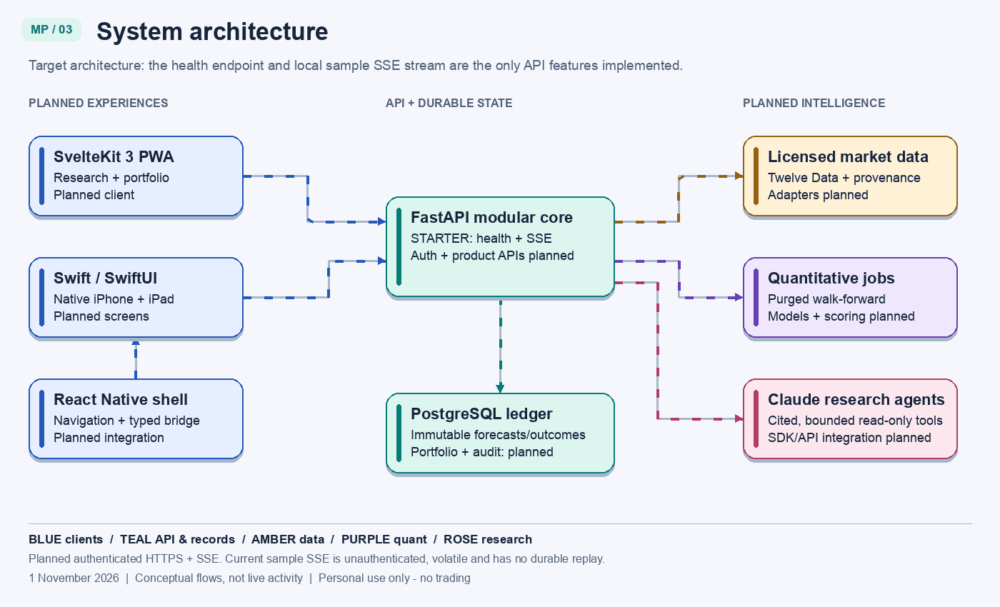

# Mypaisaa Prediction

Personal investment intelligence: its own portfolio ledger/imports, rules, XIRR, research, transparent predictions and disciplined outcome measurement. It provides decision support and education; it never executes or routes trade orders.

**Starter implementation · Personal use · No trading · Production not deployed**

As of **1 November 2026**, the runnable product code consists of FastAPI health and sample SSE routes. The static site is an illustrative preview. Authentication, durable records, providers, models, agents and web/native product apps remain planned. [Current status and roadmap](docs/implementation-plan.md#current-implementation-status) separates those states explicitly.

**Current planning direction:** [DEC-001–041](docs/planning/aws-options-2026-11-01/product-decisions.json) and the [layered development pack](docs/planning/layered-development-2026-11-01/README.md) capture the later owner decisions. Complete end-to-end requirements and UX agreement still gate application implementation. DEC-041 authorises realistic synthetic **local/dev fixture preparation only**; actual holdings/PDFs/screenshots arrive later, and no fixtures are loaded into AWS. Direct Anthropic client SDK on Lambda and Yahoo Finance + Twelve Data Grow replace the earlier Agent SDK/feed assumptions. The £100 all-in envelope replaces the earlier £50 AWS-only planning target; the final architecture and ML options A/B remain unselected.

| Read next | What it answers |
| --- | --- |
| [MA concept reconciliation and architecture finalisation](docs/planning/ma-reconciliation-2026-11-02/README.md) | Current 2 November research/gap closure pack, pending architecture decisions, phase/story structure and pre-UX sign-off; no implementation authority |
| [Layered development pack](docs/planning/layered-development-2026-11-01/README.md) | Current draft entry point, scope, approval boundaries and validation evidence |
| [Portfolio/import specification](docs/planning/layered-development-2026-11-01/portfolio-import-spec.md) | Standalone ledger, all v1 import methods, review/commit/reversal and audit contracts |
| [Phased delivery plan](docs/planning/layered-development-2026-11-01/phased-delivery-plan.md) | PH-00–PH-09, planning versus implementation dependencies and evidence gates |
| [Architecture blueprint](docs/planning/layered-development-2026-11-01/architecture-blueprint.md) | Latest proposed boundaries, serverless options, durable work, costs and open ADRs |
| [AWS and forecasting deep dive](docs/architecture-deep-dive.md) | Native Lucid request, EventBridge/SQS/Haiku batching and SageMaker forecast diagrams with detailed integration and failure contracts |
| [Technology matrix](docs/planning/layered-development-2026-11-01/tech-stack-matrix.md) | Current dependency evidence versus intended components, interfaces and alternatives |
| [Architecture](docs/architecture.md) | Canonical overview with current-direction notices and retained bootstrap visuals |
| [Technology stack](docs/tech-stack.md) | Runnable starter versions, target preferences and historical dependency drift |
| [Knowledge base](docs/knowledge-base.md) | Product intent, working decisions and open questions |
| [Implementation plan](docs/implementation-plan.md) | Earlier six-phase roadmap, exit criteria and dated manual Jira links |
| [Visual sources](docs/diagrams/README.md) | Editable Lucidcharts, animated companions and static alternatives |
| [Plan-sync record](docs/plan-sync-2026-11-01.md) | The dated local/Jira/Confluence evidence and remaining delivery steps |

## Product boundaries

- **Personal use only.** One operator, least-privilege access, no multi-tenant roadmap in the initial release.
- **Initial coverage:** approved holdings and a proposed balanced research watchlist, initially 20–30 UK/US/India instruments. Per-listing identity, rights, history and freshness must be verified before live use; broader markets/themes require approval and cost evidence.
- **Not investment advice.** Every prediction is probabilistic, explainable, timestamped, and paired with uncertainty and validation context.
- **No execution.** There are no broker credentials, order endpoints, trade buttons, or agent permissions to transact.

## Architecture at a glance

| Boundary | Current intended direction; all product capabilities remain planned |
| --- | --- |
| Clients | SvelteKit 3 PWA; Swift/SwiftUI product surfaces inside a React Native shell |
| Identity/API | Cognito managed Apple/Google/passkeys; FastAPI on Lambda; authenticated HTTPS and bounded resumable SSE |
| Data/records | Yahoo Finance + Twelve Data Grow; private S3 evidence; DynamoDB preferred subject to ledger-fit proof |
| Science/research | Rules/XIRR plus ML and structured LLM factors; direct Anthropic client SDK loop; immutable predictions and mature outcomes |
| Operations | Separate dev/prod authority; launch cost/audit visibility; £100 all-in planning envelope; ML execution A/B and workflow choices open |

The [new blueprint](docs/planning/layered-development-2026-11-01/architecture-blueprint.md) describes the target options and trust boundaries. The original accepted single-host/PostgreSQL ADR remains a **bootstrap baseline awaiting reconciliation**, not the chosen architecture for the expanded requirements. No deployed production footprint is claimed. Significant architecture drawings use Lucidchart with native technology components.

The [new technical deep dive](docs/architecture-deep-dive.md) and [three native Lucid exports](docs/diagrams/aws-e2e-2026-11-01/manifest.json) trace the UI request, queues, Claude on Anthropic, bounded Haiku batches, two proposed SageMaker ML families, monitoring and recovery. SageMaker is the user's requested diagram direction; its deployment/cost ADR remains open. The diagram counts describe proposed logical routes and model families, not running agents or approved production endpoints.

The same MP-18 deep dive is [published in the MP Confluence space](https://duttaarun2015.atlassian.net/wiki/spaces/mypaisaapr/pages/4981639) with three native attachments. Its dated Lucid exports and manual publication record are saved in this repository.

## Visual guides

The retained bootstrap animation follows the **planned** clients, API, data and prediction flow. It predates the expanded serverless/cost/import requirements and is not a complete drawing of the new blueprint. Moving connectors explain sequence; they are not live traffic, deployed services or measured prediction accuracy. Blue denotes clients, teal API/records, amber data, purple quantitative work, rose research/consent and navy operations; labels carry the same meaning without colour.

[Static system image](docs/diagrams/system-architecture.png) · [Editable system Lucidchart](https://lucid.app/lucidchart/3ac220d1-225e-43ea-ac44-361d0c369e69/edit)

The native Lucid export below preserves the **historical accepted bootstrap** single-host AWS footprint, using AWS service components. It is not the current expanded architecture selection. No resource or region has been provisioned by this documentation work.

[Open the historical AWS Lucidchart](https://lucid.app/lucidchart/f9a80493-7f58-44c1-b201-e97034a1398c/edit) · [Diagram sources, snapshots and motion alternatives](docs/diagrams/README.md). GIFs loop; use the static images if motion is distracting. The table above remains a readable fallback.

[Current editable A/B planning comparison](https://lucid.app/lucidchart/02218133-613a-4b78-aea4-e0dba26db386/edit) · [Plan A native export](docs/planning/aws-options-2026-11-01/option-a-lucid.png) · [Plan B native export](docs/planning/aws-options-2026-11-01/option-b-lucid.png). A/B remain unselected; C is retired. These manually saved exports need an approved update for the complete new blueprint and do not demonstrate deployed services or automatic synchronization.

## Start here tomorrow

Start with the [layered development pack](docs/planning/layered-development-2026-11-01/README.md) and latest decision register, then use the [knowledge base](docs/knowledge-base.md) for the broader reference trail. Read the [current implementation status](docs/implementation-plan.md#current-implementation-status) to distinguish the runnable starter from planned capabilities. SvelteKit 3 is [officially available](https://svelte.dev/blog/sveltekit-3-is-here), but is not installed in this app.

## Repository layout

| Path | Purpose |
| --- | --- |
| backend/ | Runnable FastAPI health/sample SSE starter and tests; planned home for agents, data pipelines and models |
| web/ | Placeholder for the planned SvelteKit 3 PWA |
| mobile/native-ios/ | Placeholder for the planned native Swift/SwiftUI iOS/iPadOS app and domain modules |
| mobile/rn-shell/ | Placeholder for the planned React Native navigation and bridge shell |
| infra/ | Placeholder directories for future local containers and AWS infrastructure as code; no executable infrastructure definition yet |
| docs/ | Architecture, phased implementation plan, cost guardrails, and ADRs |

## Local development

The API is runnable today. The web and mobile directories are placeholders without build manifests. Use Python 3.12 and uv 0.12.9 for the current locked backend environment; web and native toolchains will be established when those apps are implemented.

~~~sh
cd /Users/arundutta/projects/mypaisaa-prediction
cp backend/.env.example backend/.env
uv sync --project backend --frozen --extra dev --python 3.12
uv run --project backend --frozen --extra dev uvicorn app.main:app --reload
~~~

The API health endpoint is at http://localhost:8000/api/v1/health; the sample SSE endpoint is /api/v1/stream. The separate static product preview is in `site/dist/index.html`.

The starter runs without market-data or Claude credentials. Do not put keys in source control. Any future credential setup follows the project's secret-handling rules and requires its own authorised implementation scope.

## Quality gates

~~~sh
uv lock --project backend --check
uv run --project backend --frozen --extra dev ruff check backend
uv run --project backend --frozen --extra dev pytest backend/tests -q
python3 -m unittest discover -s tests -v
~~~

Before implementing an endpoint, pipeline, model, or agent, read [AGENTS.md](AGENTS.md). In particular, predictive work must use time-aware split logic and record every published prediction before its outcome is known.

For Codex review rounds, [the review optimisation note](docs/review-optimisation.md) explains risk-based test selection, evidence reuse, regression coverage, and when expensive suites run. Required release gates still apply before shipping.

[GitHub delivery and CI](docs/github-workflow.md) defines `main`, issue branches, PRs, current checks and the GitHub plan restriction that currently prevents server-side branch protection.

## Delivery plan

The current draft [phased delivery plan](docs/planning/layered-development-2026-11-01/phased-delivery-plan.md) defines PH-00–PH-09. PH-00 requires complete baseline/UX agreement before implementation. PH-01 ledger/import planning can proceed locally; its implementation depends on PH-02 private platform, authentication, audit and cost foundations. Data/performance, scientific controls, research/chat, web, native and release acceptance follow their explicit dependencies. Security, costs, audit and evaluation arrive with each layer. The [earlier six-phase plan](docs/implementation-plan.md) remains a historical roadmap, not a second competing implementation sequence.

## Production stance

Do not deploy this starter as-is. Current confirmed cash planning is **£100/month all-in**, including dev/prod AWS, market data and Claude/evaluations: **£70 planned operation + £30 reserve**, with forecast cash alerts/reductions/optional-job pauses at **£60/£75/£85**. Full-scope pricing still needs validation. The reported $200 Anthropic organization credit is shared and unverified; no automatic paid fallback is approved. Live estimates and delayed billing must remain separate on the launch dashboard. See the [current cost assumptions](docs/planning/aws-options-2026-11-01/cost-model.json) and [cost/audit requirements](docs/planning/aws-options-2026-11-01/audit-observability-requirements.md). The [earlier £50 AWS-only model](docs/cost-model.md) documents the bootstrap baseline. Billing alerts/admission controls are not a universal instantaneous AWS spending cap.

## Accepted baseline and later direction

Historical accepted choices and consequences remain in [docs/adr](docs/adr):

- FastAPI and SSE for an API-light personal product
- a modular monolith on a small AWS host in the bootstrap baseline
- append-only prediction and outcome tracking
- purged walk-forward validation rather than random splits
- Swift-native feature surfaces inside a React Native shell
- Claude agents as bounded research tools, never trading automation

Later owner decisions change the proposed deployment, budget and research SDK direction without silently rewriting ADR status. [The blueprint's ADR backlog](docs/planning/layered-development-2026-11-01/architecture-blueprint.md#8-readiness-adrs-and-phase-alignment) lists required reconciliation. This documentation alignment is local, draft and **unreviewed**; it does not publish or automatically synchronise Confluence/Jira.

## Detailed current MP diagram (proposed)

The new native Lucidchart page 4 documents the current proposed logical system, including import/ledger approval boundaries, bounded agents, controlled learning and per-environment cost visibility. It does not select the remaining architecture alternatives or represent a deployed system.

[Editable Lucidchart](https://lucid.app/lucidchart/02218133-613a-4b78-aea4-e0dba26db386/edit) · [Native-export provenance](docs/planning/layered-development-2026-11-01/visuals/architecture-lucid-manifest.json) · [Static import workflow](docs/planning/layered-development-2026-11-01/visuals/import-workflow.png) · [Opt-in workflow animation](docs/planning/layered-development-2026-11-01/visuals/import-workflow.gif).

## Detailed VPC and network options (unselected)

[Technical network appendix](docs/planning/layered-development-2026-11-01/network-topology-options.md) compares N0 customer-VPC-unattached Lambda, optional N1 isolated jobs across two AZs with gateway endpoints, and conditional NAT/public egress. Subnets, route tables, ENIs, security groups, endpoint policies, managed-service boundaries and cost consequences are explicit. These are unselected planning options; no VPC or other resource is provisioned.

[Native Lucid page-5 evidence](docs/planning/layered-development-2026-11-01/visuals/network-lucid-manifest.json) · [MP alignment proposal](docs/planning/layered-development-2026-11-01/mp-sync-write-proposal.md).
