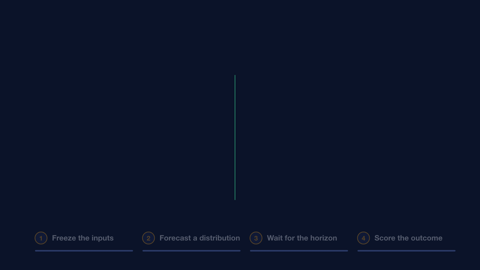

<div align="center">

<picture>
  <source media="(prefers-reduced-motion: reduce) and (prefers-color-scheme: dark)" srcset="docs/brand/mark-dark.svg">
  <source media="(prefers-reduced-motion: reduce)" srcset="docs/brand/mark.svg">
  <source media="(prefers-color-scheme: dark)" srcset="docs/brand/mark-animated-dark.svg">
  
</picture>

# Mypaisaa Prediction

### Show the uncertainty. Score every forecast.

**A private research tool for long-term investing in US, UK and Indian shares and ETFs.<br>
Code does the maths, models forecast with honest ranges, Claude explains the evidence, and you decide. It never trades.**

<a href="#where-it-stands"></a>
<a href="TECH-STACK.md#9-monthly-cost"></a>
<a href="#the-four-rules"></a>
<a href="https://github.com/gilipersonal/mypaisaa-prediction/actions/workflows/verify.yml"></a>

<a href="TECH-STACK.md"></a>
<a href="TECH-STACK.md"></a>
<a href="TECH-STACK.md"></a>
<a href="TECH-STACK.md"></a>
<a href="TECH-STACK.md"></a>
<a href="TECH-STACK.md"></a>
<a href="TECH-STACK.md"></a>
<a href="TECH-STACK.md"></a>
<a href="TECH-STACK.md"></a>

**[Architecture](ARCHITECTURE.md) · [Tech stack](TECH-STACK.md) · [AWS architecture in Lucid](https://lucid.app/lucidchart/65667c0c-9413-4c63-863d-a60b6e67ba26/edit) · [Jira board](https://duttaarun2015.atlassian.net/jira/software/projects/MP/boards/167/backlog) · [Confluence](https://duttaarun2015.atlassian.net/wiki/spaces/mypaisaapr/pages/4981720)**

</div>

---

> [!IMPORTANT]
> **Status: planning.** The architecture directions are chosen (ARC-01 to ARC-12, 2 November 2026) but the full
> baseline is not yet signed off. What runs today is a FastAPI starter with a health route and a sample SSE stream,
> the synthetic test-data tools, and CI. Nothing is deployed, no live data is fetched and no model is called. The
> order from here is fixed: sign off the architecture, then design the whole UX, then approve it, and only then build.

Mypaisaa Prediction (MP) helps one owner understand their holdings and judge where to add, hold, pause or trim. It
keeps its own record of what you own, from CSV, Excel, PDF statements, screenshots or typed entries, and checks it
against the market every day. Forecasts come from numerical models as ranges, never single numbers: next day, 5, 10
and 20 trading days, and 3, 6 and 12 months, with separate 3 to 5 year scenarios. Each forecast is frozen when it is
made and graded only after its horizon has passed, so the record of how well MP forecasts is honest by construction.
Claude reads filings and news, extracts what a statement says, and explains a recommendation in plain words. It
cannot change a number, publish a forecast, move money or trade.

<div align="center">



<sub>The life of one forecast: freeze the inputs, forecast a distribution, wait for the horizon, score the outcome. Illustrative values. <a href="docs/motion/forecast-lifecycle.png">Still image</a>.</sub>

</div>

## Contents

- [The four rules](#the-four-rules)
- [What it will do](#what-it-will-do)
- [Where it stands](#where-it-stands)
- [Documentation](#documentation)
- [How it gets built](#how-it-gets-built)
- [What is in the repository](#what-is-in-the-repository)
- [Run the starter](#run-the-starter)
- [Checks](#checks)
- [How work is done here](#how-work-is-done-here)

## The four rules

1. **Numbers come from code and models, words from Claude.** Ledger figures, returns and XIRR are computed in
   Python. Forecasts come from evaluated numerical models. Claude explains, and every figure it quotes must come from
   a versioned tool result. A convincing explanation is not evidence of forecasting skill.
2. **Every forecast is frozen, then graded.** A forecast records its data cutoff, model version, horizon and full
   distribution. It is scored only after the horizon ends, against a published outcome, and is never rewritten.
3. **Nothing changes without you.** Imports become proposals until you approve the exact change. A better model
   runs in shadow beside the live one and is promoted only with your approval and its evidence. Between promotions
   the engine corrects itself within limits: code grades every matured forecast and makes small calibration and
   weighting adjustments inside limits you approved (at most 5 points a week on a probability and 10% a month on a
   signal's weight), rolling back if scores worsen. A new model must first run 8 weeks in shadow, and a promoted model
   that slips reverts by itself and tells you.
4. **It cannot trade.** MP holds no broker login, submits no order and gives no personalised financial advice. It
   is decision support with its uncertainty on show.

## What it will do

| | What you get | How |
| --- | --- | --- |
| **Holdings** | One record of what you own across accounts, in GBP, USD and INR | Imports from CSV, Excel, PDFs, screenshots and manual entry. Anything uncertain stays a draft until you approve it. |
| **Coverage** | 20 to 30 shares and ETFs to start, from your holdings and a watchlist | Yahoo Finance and Twelve Data Grow, each listing checked for rights and freshness. More markets later through adapters. |
| **Forecasts** | Ranges for 1 day, 5, 10 and 20 trading days, and 3, 6 and 12 months | Baselines first, then bounded challengers, each qualified per task and horizon on walk-forward evidence. |
| **Scenarios** | 3 and 5 year downside, central and upside cases | Templates with assumptions you can edit. "Central" claims no likelihood. |
| **Monitoring** | Quote and risk checks every 30 minutes and a 07:30 briefing | Push to the app and the PWA, with quiet hours from 22:00 to 07:00. |
| **Recommendations** | Add, hold, pause, trim or rebalance, with reasons and uncertainty | Where the rules, the models and the research disagree, MP shows it, and it abstains when the evidence is thin. |
| **Chat** | Ask why about any recommendation | Claude answers from cited, versioned evidence through read-only tools. |

## Where it stands

| Status | What |
| --- | --- |
| **Runs today** | FastAPI starter (`/api/v1/health` and a sample SSE stream), synthetic market and document fixtures, nine CI checks |
| **Owner-selected** | Twelve architecture directions (ARC-01 to ARC-12), the horizons, and twelve policy answers from 2 November 2026 |
| **Draft** | Data, financial and forecast contracts, the phase and story baseline (PH-00 to PH-09), cost scenarios, the admin journeys |
| **Not built** | Sign-in, the ledger and imports, live data, models, agents, the web app, the Apple app, and all AWS infrastructure |

The £100 a month all-in ceiling (dev and prod AWS, market data, Claude and evaluations) is chosen. With the owner's
choices of 2 and 3 November 2026 (Twelve Data Grow 55, Virginia, the existing domain) a month comes to about £46.48,
or £54.73 with Claude on, inside the £70 operating plan; the Apple Developer fee month is the one allowed exception. [TECH-STACK.md](TECH-STACK.md#9-monthly-cost) has the breakdown.

## Documentation

| Document | What it covers |
| --- | --- |
| [ARCHITECTURE.md](ARCHITECTURE.md) | How MP is built: the system on AWS, the journeys through it, the records, forecasting science, Claude's authority, security, and the twelve selected directions. With the Lucid diagrams and animations. |
| [TECH-STACK.md](TECH-STACK.md) | The stack layer by layer with the reason for each choice and its status, the locked versions of what runs today, and the monthly cost against the £100 ceiling. |
| [The AWS architecture in Lucid](https://lucid.app/lucidchart/65667c0c-9413-4c63-863d-a60b6e67ba26/edit) · [source](docs/diagrams/mp-architecture-2026-11-02/) | Two native pages on AWS 2024 shapes: the system with numbered flows, and who may do what. Exports and manifest in the repo. |
| [Policy answers, 2 Nov 2026](docs/planning/foundation-policy-discussion-2026-11-02.md) | The owner's twelve later decisions: daily clocks, approvals, backfill, experiment ceilings, retention. |
| [Foundation Pack 1](docs/planning/foundation-specifications-2026-11-02/README.md) | Data, financial and forecast contracts, schemas, worked examples and the cost model. |
| [Selected directions](docs/planning/ma-reconciliation-2026-11-02/direction-summary.md) | ARC-01 to ARC-12 and their boundaries. |
| [Phase and story baseline](docs/planning/ma-reconciliation-2026-11-02/phase-story-baseline.json) | PH-00 to PH-09, dependencies and proposed acceptance. |
| [Synthetic test data](docs/synthetic-test-data.md) · [import samples](docs/synthetic-import-samples.md) | Real instrument identities with simulated prices, and PDF and screenshot samples for the importers. |
| [ADRs](docs/adr/) · [knowledge base](docs/knowledge-base.md) | Decision history. Older choices (PostgreSQL, a single host, the Agent SDK) are superseded by the directions above. |
| [The mark](docs/brand/README.md) · [motion](docs/motion/README.md) | The logo, its animation and palette, and how every GIF here is rebuilt from source. |

## How it gets built

Ten phases, each with a gate. These are planning layers, not dates.

| Phase | Outcome | Gate |
| --- | --- | --- |
| PH-00 | Signed-off baseline and shared contracts | Architecture sign-off, then full UX approval, before any build |
| PH-01 | Your own portfolio and every import method | Reconciliation, approval and correction work end to end |
| PH-02 | Identity, private runtime, audit and costs | Isolation, recovery, deletion and cost admission proven |
| PH-03 | Market data, performance and portfolio risk | Listing rights, calendars and freshness checked |
| PH-04 | Baselines, forecasts and controlled learning | Walk-forward evidence, outcomes, shadow and your promotion |
| PH-05 | Research, agents, chat and evaluations | Scoped tools, bounded calls, explanations that hold up |
| PH-06 | Web discovery, ranked actions and briefings | Approved responsive and accessible designs |
| PH-07 | The Apple app, offline and push | Swift and React Native contracts tested on devices |
| PH-08 | Operational acceptance and personal launch | Recovery, security, evals and reconciled cost |
| PH-09 | Extensions | New markets, providers and models qualify one by one |

## What is in the repository

| Path | What it is |
| --- | --- |
| [`backend/`](backend/) | The FastAPI starter, its lock file and tests. Its optional `data` and `agents` extras are left over from earlier plans and are not the selected stack. |
| [`docs/planning/`](docs/planning/) | Owner decisions, research, contracts, the phase and story drafts, and synthetic proofs. |
| [`docs/diagrams/`](docs/diagrams/) | Lucid exports with the scripts that draw them and their manifests. |
| [`docs/brand/`](docs/brand/) · [`docs/motion/`](docs/motion/) | The mark and the documentation animations, each with the script that builds it. |
| [`scripts/`](scripts/) · [`tests/`](tests/) | Synthetic-data generators, review and PR tooling, and their tests. |
| [`site/`](site/) | A static concept and architecture presentation. It is documentation, not the product app. |
| [`review/`](review/) | Independent-review findings, the fixed-findings ledger and round state. |
| `web/`, `mobile/`, `infra/` | Reserved for the product apps and infrastructure. Empty until the build is approved. |

## Run the starter

Python 3.12 and uv 0.12.9 (the version CI pins). No keys are needed.

```bash
git clone https://github.com/gilipersonal/mypaisaa-prediction.git && cd mypaisaa-prediction
```

```bash
uv sync --project backend --frozen --extra dev --python 3.12
```

```bash
uv run --project backend --frozen --extra dev uvicorn app.main:app --reload --app-dir backend
```

Then open [`localhost:8000/api/v1/health`](http://localhost:8000/api/v1/health) or the sample stream at
[`localhost:8000/api/v1/stream`](http://localhost:8000/api/v1/stream).

## Checks

```bash
uv run --project backend --frozen --extra dev ruff check backend && uv run --project backend --frozen --extra dev pytest backend/tests -q
```

```bash
python3 docs/readme/check_readme.py
```

```bash
python3 scripts/review_checks.py --base origin/main --run
```

The first runs the backend gates. The second checks these three documents' links, the mark's SVGs and
reduced-motion fallbacks, and every GIF's frames and still image. The third picks and runs the checks for whatever
a branch changed. CI runs nine checks on every pull request (Backend, Docs, Review tooling, Agent config, Plan sync, Confluence
receipts, Static preview, Workflow lint, Jira traceability). It deploys nothing.

## How work is done here

- Every change belongs to an MP issue on the [Jira board](https://duttaarun2015.atlassian.net/jira/software/projects/MP/boards/167/backlog),
  on a branch named `MP-<n>-<slug>`, merged into `main` through a pull request titled `[MP-<n>] <title>`.
- A pull request, a merge and closing an issue each need the owner's word in the request that is running.
- Independent review is offered at the end of the work and runs a round at a time, each round on a fresh yes:
  gates first, blind reviewers in parallel lanes, later rounds on the changes only, at most five rounds.
- Nothing is applied to AWS and no paid service is called without an explicit request. IaC here is plan-only.
- [AGENTS.md](AGENTS.md) holds the working agreement for every contributor, human or agent.

<sub>The mark, "the Fan", is the documentation identity and is proposed for the app, pending UX approval. See [docs/brand](docs/brand/README.md).</sub>
