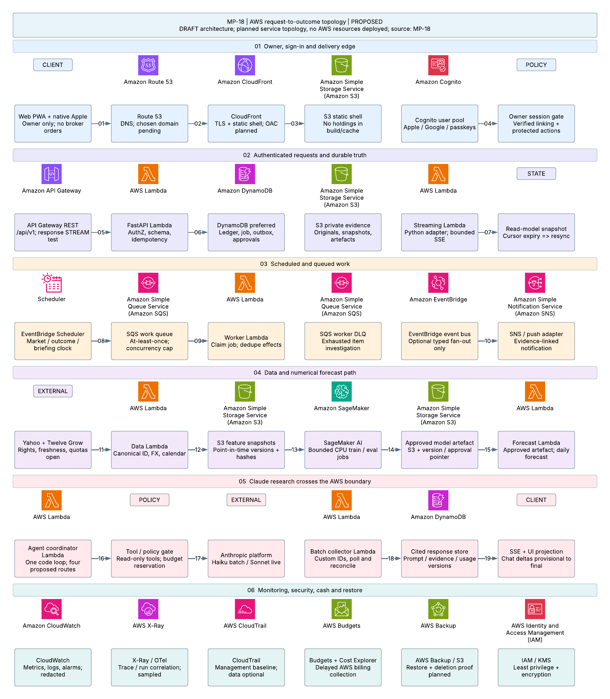
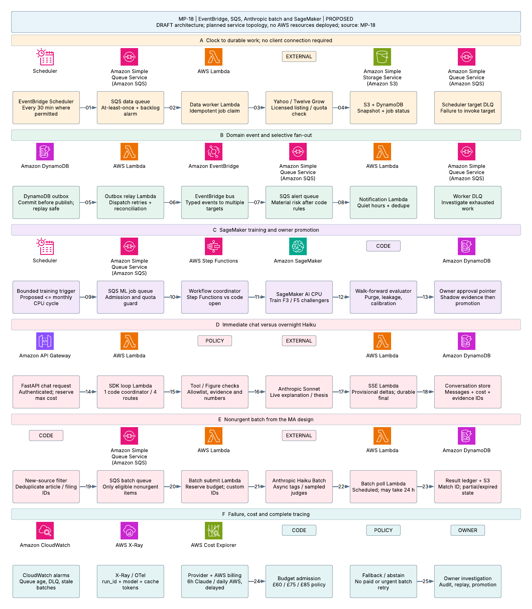
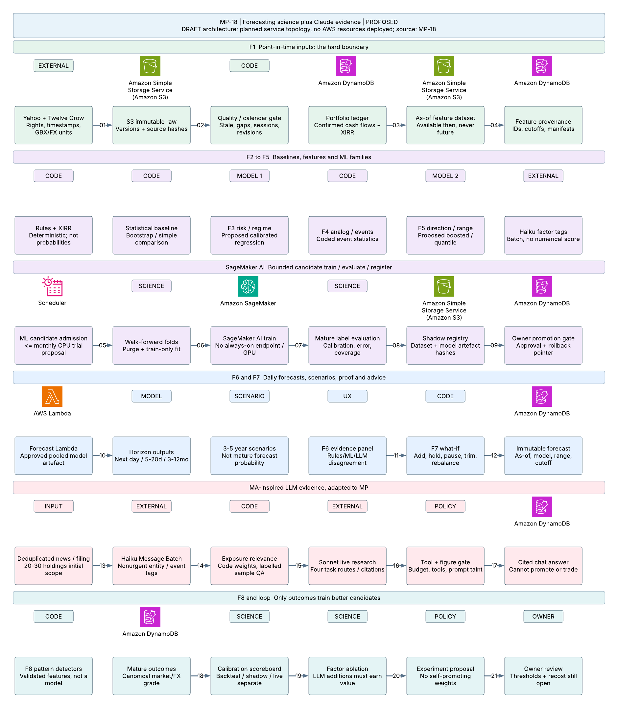

# Mypaisaa Prediction: AWS, Anthropic and forecasting architecture

**MP-18 · 1 November 2026 · detailed design proposal**

This document follows a holding and a market observation from the device through an authenticated AWS API, durable work queues, numerical forecasts, Claude research, notifications and outcome scoring. It is an architecture design for the separate personal Mypaisaa Prediction application. The only running product backend remains the FastAPI health/sample SSE starter. No AWS resources or ML/agent product services were deployed by this work.

The latest request asks to show **SageMaker AI** as the proposed ML execution service and to adapt the **Haiku batching** idea from mypaisa-agent. Those are diagram directions, not a final production ADR or a validated £100/month bill. The existing A/B evaluation of portable jobs versus selective SageMaker and N0/N1/N1-E network options remains open until measured cost and compatibility evidence supports a choice. The app never places trades.

## The three native Lucid views

| View | What it answers | Editable source |
| --- | --- | --- |
| [AWS request to outcome](diagrams/aws-e2e-2026-11-01/aws-request-topology.png) | From web/Apple UI through DNS, CloudFront, Cognito, API Gateway, FastAPI/Lambda, DynamoDB/S3, scheduled queues, SageMaker, Anthropic and system monitoring | [Lucid page 6](https://lucid.app/lucidchart/02218133-613a-4b78-aea4-e0dba26db386/edit) |
| [EventBridge, SQS, Haiku batch and SageMaker](diagrams/aws-e2e-2026-11-01/aws-events-batching.png) | Which events go to which queue, separate failure paths, live Sonnet, deferred Haiku batches, ML training and admission controls | [Lucid page 7](https://lucid.app/lucidchart/02218133-613a-4b78-aea4-e0dba26db386/edit) |
| [Forecasting science and Claude evidence](diagrams/aws-e2e-2026-11-01/aws-forecasting-science.png) | Point-in-time data, F1–F8 modules, numerical baselines and model families, owner promotion, LLM factors and mature outcome grading | [Lucid page 8](https://lucid.app/lucidchart/02218133-613a-4b78-aea4-e0dba26db386/edit) |

The existing [native VPC alternatives](planning/layered-development-2026-11-01/visuals/mp-network-options-native.png) remain the physical network companion (Lucid page 5). Every new diagram uses coloured bands and native AWS service shapes where there is an AWS service. Short numbered arrows keep the image readable; [the complete arrow key](diagrams/aws-e2e-2026-11-01/connections.json) spells out their contracts. Adjacent arrows are visual paths, while cross-band interfaces are listed below. These exports are static and accessible without motion; the [private architecture atlas](https://mypaisaa-prediction.duttaarun2015.chatgpt.site/architecture/) offers an opt-in animated overview. The live Lucid document is editable; the PNGs and [export manifest](diagrams/aws-e2e-2026-11-01/manifest.json) are dated snapshots, not automatic sync.

## Counts: responsibilities, Claude routes and numerical models

| Item | Proposed initial count | Meaning and boundary |
| --- | ---: | --- |
| Logical responsibilities inherited as reference from MA | **9** | Concierge, data steward, news scout, deterministic analyst, forecaster, grader/tuner, operations warden, budget keeper and owner/admin desk. This is a requirements inventory, not nine Lambda processes or nine Claude calls. |
| MP code coordinator and Claude task routes | **1 + 4** | One bounded server-controlled `anthropic` client-SDK loop with four proposed routes: portfolio analysis, forecast explanation, source research and long-term thesis. The exact production catalogue remains to agree. |
| Anthropic model classes | **2 candidate routes** | Haiku class for bounded tagging/extraction, simple filtering and eligible asynchronous batch work; Sonnet class for live multi-source conversation, explanation and thesis. Exact model IDs, effort, limits and fallback rules need evaluation and pinning. No default Opus tier is assumed. |
| Trainable SageMaker model families | **2 proposed initial families** | F3: a simple calibrated regression family for regime/downside or direction probabilities. F5: gradient-boosted/quantile challengers for direction and return ranges. The precise F3 algorithm is a proposal; target, horizon and approved artefact counts are not yet fixed. |
| Deterministic comparison methods | **2 starting groups** | Rules/XIRR plus statistical or block-bootstrap baselines; coded analog/event studies. F8 patterns are validated features, not an extra trained model by default. |

F1 is source/data lineage, F2 is the walk-forward lab, F6 is explanation/proof, and F7 is contribution/rebalancing simulation. They are not additional SageMaker endpoints. Pooled model artefacts should be indexed by task, horizon, instrument kind, eligible universe and approved version. Additional market-specific versions depend on evidence. One model per ticker and one Claude call per 30-minute quote refresh are outside the proposed initial cost shape. The role and F1–F8 mapping is grounded in the [forecasting scope](planning/aws-options-2026-11-01/forecasting-scope.md); the counts above are explicit MP-18 proposals, not pre-existing owner decisions.

## A request from the UI

1. The planned SvelteKit 3 PWA or SwiftUI surface inside the React Native shell opens a domain chosen later. Route 53 resolves it. CloudFront delivers the proposed static shell from private S3 with Origin Access Control; no personal holdings are embedded in the build or shared edge cache. Static versus SSR stays an ADR.
2. Cognito manages the owner sign-in with Apple, Google and passkeys, subject to verified account linking and recovery tests. The client carries an appropriate session proof to the API. The API validates owner, environment, schema and protected-action permission; email equality is not a linking policy.
3. API Gateway routes versioned REST requests to a typed FastAPI Lambda. A command is assigned a client idempotency key, checks a conservative cost reservation where it might incur spend, and commits a durable job or business record in the preferred DynamoDB design. Imports, approvals and forecasts append versions; they do not rewrite history. S3 keeps private originals and versioned feature/model evidence. DynamoDB's exact financial transaction fit is still a proof gate.
4. A long operation returns a durable accepted-job reference. A separate authenticated SSE route provides progress and provisional chat deltas. The proposed implementation needs a **REST API AWS_PROXY integration with `responseTransferMode=STREAM`** and a compatible Python Lambda streaming adapter/custom runtime; the starter's buffered/local SSE example does not establish it. Streams are bounded by platform limits, heartbeat and reconnect policy. An expired cursor makes the client fetch an authenticated snapshot, not restart paid work. See [API Gateway response streaming](https://docs.aws.amazon.com/apigateway/latest/developerguide/response-transfer-mode.html) and [Lambda response streaming](https://docs.aws.amazon.com/lambda/latest/dg/configuration-response-streaming.html).
5. A worker writes the final business result and an outbox intent before a relay publishes any notification. SSE, app/chat history and push read that durable result. A dropped network connection never reverses a committed import or silently repeats a model request.

CloudFront, Route 53, API Gateway, Cognito, S3 and DynamoDB are AWS managed services outside customer subnets. This diagram does not put them inside a drawn VPC. No physical Region, account, subnet, CIDR, identity pool or origin route is provisioned by the drawing.

## Schedule, event bus, SQS and failure paths

These services have different jobs; using them all on one path without a reason would add cost and ambiguity.

| Component | Where it is proposed | What it must not be mistaken for |
| --- | --- | --- |
| **EventBridge Scheduler** | Clock for supported 30-minute quote/risk observation, daily formal forecast, outcome maturity, morning briefing, bounded batch polling and optional training admission. Each schedule targets a queue or workflow and has an explicit retry policy plus its own **standard-SQS target DLQ** for failure to invoke the target. | It does not store the full business job, guarantee a forecast result, or replace the worker queue. |
| **SQS work queues** | Separate proposed queues for market ingestion, forecast/evaluation, nonurgent Haiku batch submission and notification delivery, with per-consumer concurrency/visibility/retry policy. A Lambda worker claims a durable job ID conditionally and may receive the same message again. | SQS delivery is at least once. A FIFO name alone does not make external provider calls or financial commits exactly once. |
| **SQS worker DLQs** | Exhausted worker messages go to a different DLQ from Scheduler target failures. Queue-age, visible-message and DLQ-count alarms lead to human investigation and controlled replay. Partial batch failures are reported per item. | A DLQ is not an automatic data correction or a reason to retry a paid call blindly. |
| **DynamoDB job/outbox** | Accepted command, owner/environment, idempotency key, state transitions, reserved spend and unpublished delivery intent survive process loss. A relay reconciles any committed outbox row whose dispatch was not confirmed. | A process-local SSE queue and an EventBridge event do not replace this durable truth. |
| **EventBridge event bus** | Add a typed domain-event route only when one committed event needs independent consumers, such as a risk rule, read-model updater and notification route. Apply content-based rules and target-specific retries. | The event bus is a router, not the Scheduler, the primary work queue or a global exactly-once ledger. |
| **Step Functions / durable alternative** | A bounded multi-stage training/recovery run may need checkpoints and explicit compensations. Step Functions is shown as a candidate coordinator; its use versus a simpler job state machine or supported Lambda Durable Functions must be costed and selected. | It does not grant agents permission, keep a client SSE connection alive or approve a new model. |

The intended market path is `Scheduler → SQS data queue → ingestion Lambda → permitted Yahoo/Twelve Data Grow adapter → S3 source snapshot + DynamoDB job state → deterministic rules/forecast queues → immutable forecast/outbox → optional EventBridge fan-out → in-app/push delivery`. Both Scheduler target failure and worker exhaustion have separate DLQs. Input validation, source freshness, listing units, rate caps and source licences are per-instrument gates. If intraday data is unavailable, the app uses labelled daily analysis and withholds unsupported live alerts. [Scheduler target and DLQ](https://docs.aws.amazon.com/scheduler/latest/UserGuide/managing-targets.html), [Scheduler DLQ](https://docs.aws.amazon.com/scheduler/latest/UserGuide/configuring-schedule-dlq.html), [Lambda with SQS](https://docs.aws.amazon.com/lambda/latest/dg/with-sqs.html).

## SageMaker AI: what it trains, and what is allowed to go live

The user-requested SageMaker scenario uses short-lived, capped CPU training/evaluation jobs over S3 point-in-time datasets. A candidate is reproducible from data/feature/model hashes, calendar and FX rules, splits, parameters, seeds, reference source versions and cost/run ID. Chronological rolling or expanding folds purge/embargo overlapping labels. Imputation, scaling, feature selection and calibration fit **inside each training fold**. A source revision or LLM-derived factor cannot leak future knowledge into a historical fold.

Start with rules/statistical baselines, then test the two candidate trainable families above. Compare mature outcomes, benchmark-relative quality, calibration, error, coverage, stability and incremental cost. Test ML-only against ML plus versioned Haiku-derived structured factors. An LLM explanation is not a price label or numerical probability. Candidates enter an immutable artefact/registry record and a shadow run. An **owner approval** changes the approved-version pointer only after the evidence gate. Inference from an approved portable artefact can run in a bounded Lambda for a small daily universe; selective SageMaker Batch Transform can be compared for larger scheduled workloads. A continuously running endpoint or GPU is not assumed. Serverless inference is a separately costed alternative, not a selected dependency. [SageMaker training jobs](https://docs.aws.amazon.com/sagemaker/latest/APIReference/API_TrainingJob.html), [Batch Transform](https://docs.aws.amazon.com/sagemaker/latest/dg/batch-transform.html), [serverless inference](https://docs.aws.amazon.com/sagemaker/latest/dg/serverless-endpoints.html).

Formal forecasts are daily for next day, 5–20 trading days and 3/6/12 months; 3–5-year views are explicitly scenarios. A prediction record includes as-of time, target/horizon, distribution or probability, calibration/uncertainty, model version, data cutoff and evidence. The system grades it only after the declared horizon and canonical market/FX outcome are mature. Backtest, historical reconstruction, shadow and prospective results have separate badges and scores. Corrections append linked records; they do not erase the original published prediction. A new training result never promotes itself.

## The Claude path and the MA-inspired Haiku batch lane

MA's [agent design](https://github.com/gilipersonal/mypaisa-agent/blob/387fc38bdc99d77460b6b03d90e2637241e79d1e/ARCHITECTURE.md#L1194) describes a thin official Anthropic SDK loop, Sonnet for conversation and Haiku for short filtering. Its planned overnight Message Batches score/tag newly collected news and sample answer-quality evaluations, with code calculating relevance and all financial numbers. Its detailed caching/limit rules are in [MA architecture](https://github.com/gilipersonal/mypaisa-agent/blob/387fc38bdc99d77460b6b03d90e2637241e79d1e/ARCHITECTURE.md#L3872); this is reference material, not an MP runtime dependency or proof the MA plan is implemented.

MP adapts that pattern with **one server-controlled coordinator** and the four proposed research routes above. A live holding question takes the bounded Sonnet route when needed. The Lambda first verifies owner scope, data freshness, context/allowed tools and a maximum cost reservation. It calls the official Anthropic client SDK directly; Claude models run on the **Anthropic platform**, outside AWS. A requested tool is a proposal checked against a typed allowlist and user/environment scope before the server executes a read-only deterministic tool. A figure check compares quoted numbers against tool outputs before the final cited answer. The final message and provider usage are recorded with model/prompt/tool/evidence versions. Agents cannot place orders, change ledger values, promote models or grant themselves broader tools. Search/fetch results and imported documents are untrusted.

**Deferred lane:** newly deduplicated article/filing items, optional archive tags and bounded sampled answer-quality judges can enter an SQS batch queue. A submit worker reserves the maximum permitted spend, gives each request a stable `custom_id`, creates an Anthropic Haiku Message Batch, and stores batch/request IDs and a state machine. A scheduled poller fetches terminal results, matches them by `custom_id` because order is not guaranteed, validates the returned structured tags, records actual tokens/cost and updates cited evidence. Results can take up to **24 hours**; the daily 07:30 briefing and immediate risk alerts therefore cannot depend on a freshly submitted batch. On late/expired/failed results, show the last dated evidence or a plain deterministic template and mark the research update pending. Do not buy an automatic real-time fallback. The [Anthropic batch API](https://platform.claude.com/docs/en/api/python/messages/batches/create) and [batch guide](https://platform.claude.com/docs/en/build-with-claude/batch-processing) describe the asynchronous contract and current 50% token discount; exact model pricing, eligibility and credit treatment must be checked at activation.

For the initial 20–30 instruments, the 30-minute quote/risk poll performs **numerical provider work in code**, not one Claude call per ticker per poll. Haiku tags only new, eligible research items; code computes each item's exposure relevance and numerical score. Sample the tag quality against human-labelled cases. Stable prompt-prefix caching may reduce measured repeat cost, but a nightly batch does not guarantee a cache hit. Use one pinned model per loop and do not send warming requests. MA's own model tier IDs, nine-agent Lambda deployment and budget ladder are not copied into MP. The MP batch threshold, exact model ID, maximum items, poll interval, lag tolerance and optional judge share are design decisions, subject to the £100 all-in limit and real provider reports.

## Monitoring, cost and recovery from the first layer

Every API command, queue message, SageMaker job, provider fetch, Claude request/batch item, approval, forecast and notification carries a business ID, environment, request/run ID and source/config/model version. Trace spans may cross asynchronous boundaries by linked IDs. Logging receives redacted operational metadata, not holdings, original PDFs, private prompts or API credentials. Financial audit, source and forecast evidence are durable records with retention independent of short-lived traces.

| Signal | Proposed observation and response |
| --- | --- |
| API and Lambda | 4xx/5xx by route, latency, throttles, stream expiry/gaps, cold-start distribution and authentication denials; separate normal user errors from service faults. |
| Scheduler and queues | Target invocation failures and target-DLQ count; SQS oldest-message age, visibility/retry count, worker DLQ size and outbox lag. Alarms distinguish schedule failure from worker exhaustion. |
| Market and science | Provider quota/error and per-listing freshness; forecast-run lateness; input-quality refusal; fold leakage/invalid calibration; model drift, shadow versus live version and missing mature-outcome grade. |
| Anthropic agents and batches | Requests by route/model/environment, input/output/cache tokens, cost reservations, refusal, tool/policy failures, batch age/status/partial expiry and answer-quality sampled failures. A batch pending near the briefing cutoff uses a dated fallback. |
| Money | Internal per-run estimates/reservations immediately; Anthropic reports planned every six hours and AWS billing daily, both with source timestamps and reconciliation. Track gross, verified credit and cash liability separately. |
| Recovery and privacy | Missing/altered audit events, S3 object/version/derived-copy deletion, protected action denials, restore exercise results, stale backups and replay that could revive deleted evidence. |

CloudWatch logs/metrics/alarms are proposed for operations; X-Ray or OTel sampled traces carry correlations; CloudTrail management events provide an AWS control-plane baseline. Expensive S3/DynamoDB/Lambda data-event selection must be justified, and no sensitive value should be put in resource names/tags. Observability service choice and retention cost remain an ADR. [CloudTrail event classes](https://docs.aws.amazon.com/awscloudtrail/latest/userguide/cloudtrail-events.html). Operational defaults are 14-day logs, 30-day rich traces and 90-day run summaries; durable forecast/approval/audit retention is separately unresolved. S3 originals have a renewable 24-month archive policy with owner extension/deletion, not an approved automatic expiry. Monthly focused and change-triggered recovery exercises need a measured RPO/RTO.

The owner-confirmed **£100/month all-in cash planning ceiling** covers dev+prod AWS, market data and Claude/evaluations: £70 planned operation and £30 reserve. Forecast spend warnings at £60, reduction of optional work at £75 and pause of new optional paid jobs at £85 are application admission controls, not an immediate AWS billing kill switch. The reported shared $200 Anthropic promotional credit is unverified; no uncovered call gets an automatic paid fallback. A single pending batch reserves conservative liability for *all* its items until provider results reconcile it. Internal per-environment/agent/model/feature views partition one charge and never double-count it. AWS Budgets and Cost Explorer are delayed reports; Cost Explorer API requests have their own charge. [AWS Cost Explorer](https://docs.aws.amazon.com/cost-management/latest/userguide/ce-what-is.html). The cost of the entire SageMaker/queue/endpoint/telemetry/data/Claude design has **not** been proven under the ceiling.

## Network, security and deployment alternatives

The [detailed native network page](planning/layered-development-2026-11-01/visuals/mp-network-options-native.png) is still the physical VPC source: **N0** customer-VPC-unattached Lambda for external Anthropic/Yahoo/Grow HTTPS, **N1** optional two-AZ isolated private jobs using S3/DynamoDB gateway endpoints, and separately costed **N1-E** NAT/IGW or interface endpoint paths if full VPC attachment is justified. A gateway endpoint cannot reach Anthropic. Public subnet attachment does not itself give Lambda internet access; security groups do not filter hostnames. Managed AWS services remain outside customer subnets. SageMaker training-job VPC attachment, network isolation, data access/bootstrap and egress need their own compatibility test. [Lambda VPC internet](https://docs.aws.amazon.com/lambda/latest/dg/configuration-vpc-internet.html), [SageMaker training in a VPC](https://docs.aws.amazon.com/sagemaker/latest/dg/train-vpc.html).

IAM roles must separate API, ingestion, import, numerical training/inference, batch submission/polling, notifications and billing collection. The Anthropic credential and other secrets belong in an approved runtime secret store with no client exposure, logs or diagram metadata. Encryption, object access, retention/deletion and backup grants need explicit threat and restore tests. Dev and prod need separate write authority, stores, queues, identity configuration and cost attribution; separate accounts versus scoped resources remains open. Prefer infrastructure as code after full end-to-end requirements and UX approval. No production Region, network, endpoint, broker integration or AWS cost approval is implied by this diagram.

## Current decision gates

1. Confirm exact v1 market-source rights/tier, instrument set, calendars and source/price/fund semantics; real holdings arrive progressively, while synthetic local/dev fixtures remain the present evidence.
2. Re-cost this concrete SageMaker + SQS/EventBridge + Anthropic batch design against **all** AWS/dev/prod/data/Claude/telemetry/backup/CI costs and credit availability. Choose on-demand execution and inference path based on measured job sizes and full bill, not the presence of an icon.
3. Prove the REST streaming Python/auth/replay path, DynamoDB financial commit/outbox invariants, queue retry/DLQ behaviour, credential/owner isolation and batch partial-result recovery with synthetic failures.
4. Agree exact four-role agent contracts, model IDs/routes, batch eligibility/latency/fallback, F3/F5 targets/artifact counts, scientific promotion thresholds and an explicit versioned scorecard. Owner model approval remains mandatory.
5. Reconcile accepted bootstrap ADRs with the final AWS, Anthropic and SageMaker choices; agree complete requirements and web/native UX before application implementation. The current diagrams are decision material for that process.

The [published MP-18 Confluence deep dive](https://duttaarun2015.atlassian.net/wiki/spaces/mypaisaapr/pages/4981639) is a child of the [MP architecture blueprint](https://duttaarun2015.atlassian.net/wiki/spaces/mypaisaapr/pages/5014267). The three native images are Confluence attachments; the architecture, technology and planning hubs link to it. The [manifest](diagrams/aws-e2e-2026-11-01/manifest.json), image hashes and [sync receipt](diagrams/aws-e2e-2026-11-01/confluence-sync.json) are the comparison evidence. Confluence and Lucid do not update each other automatically.
