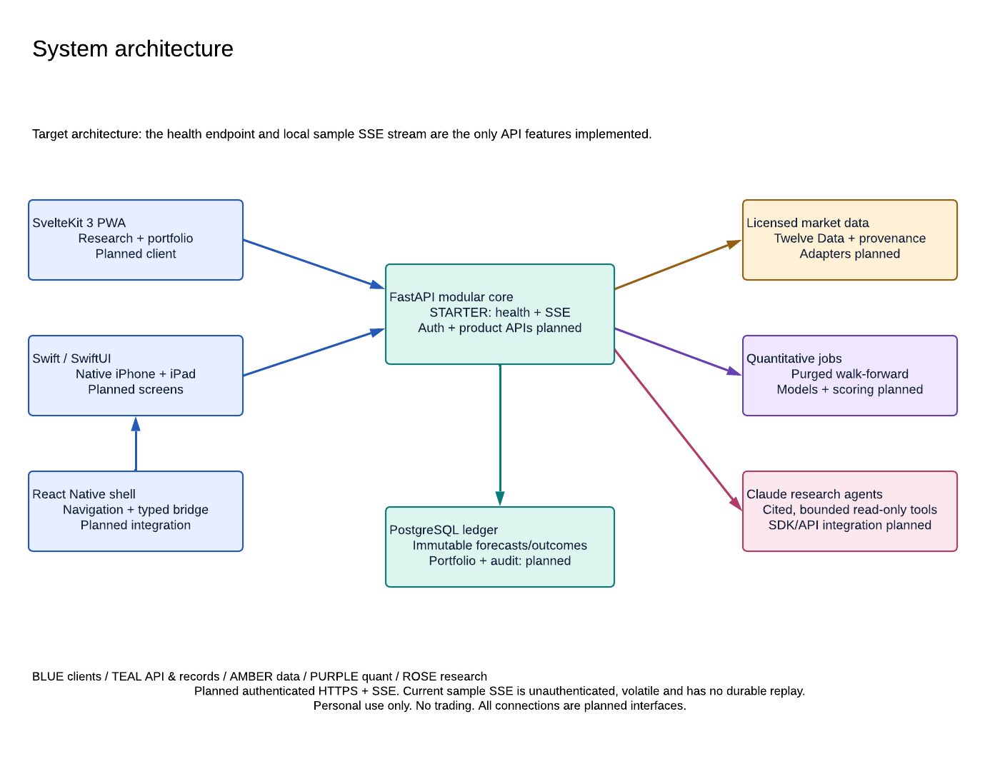
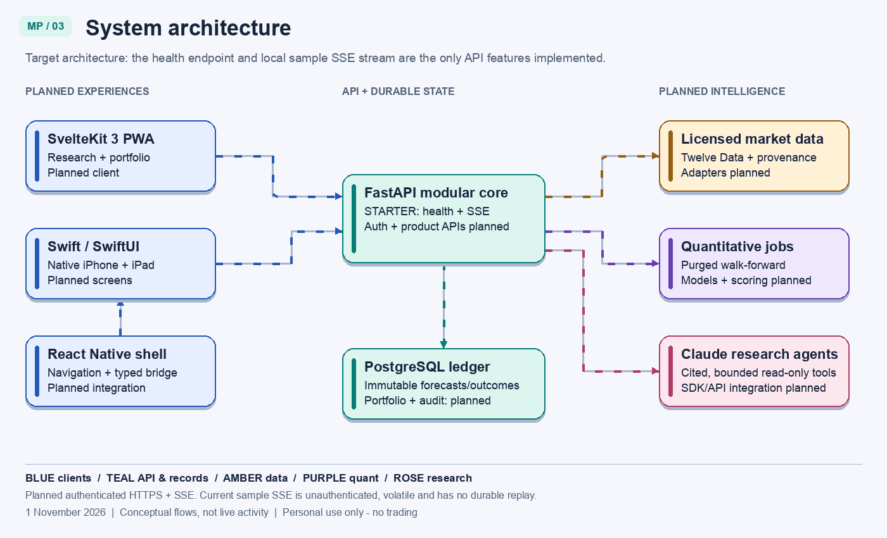
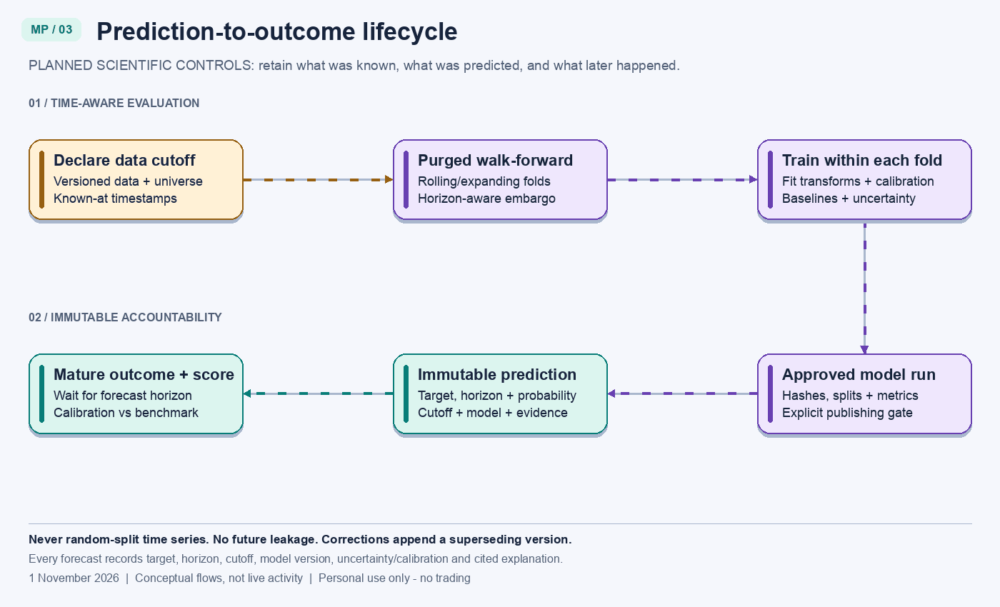
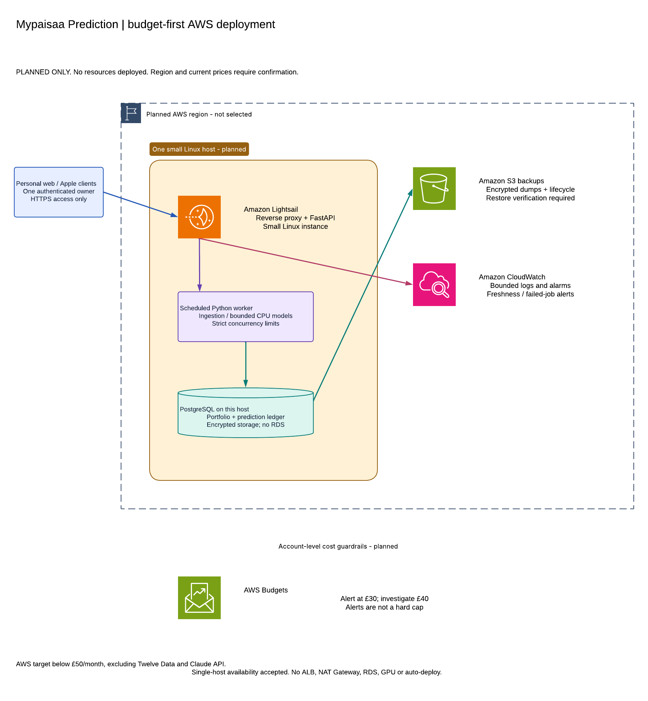
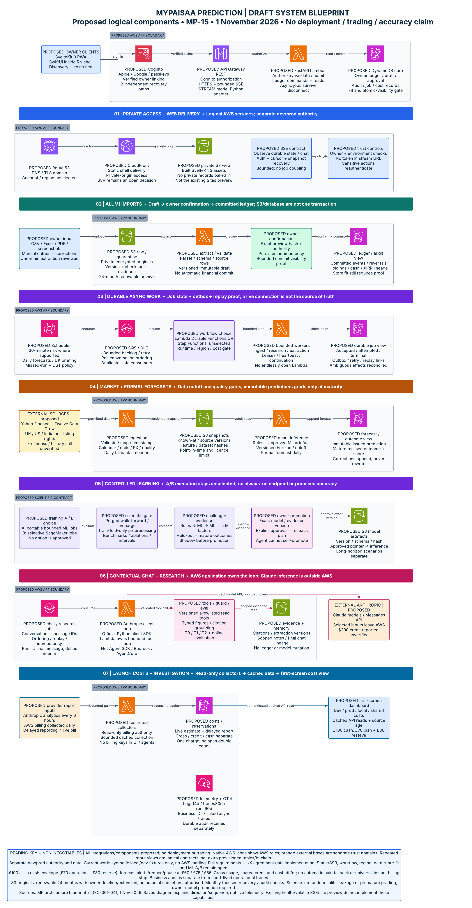
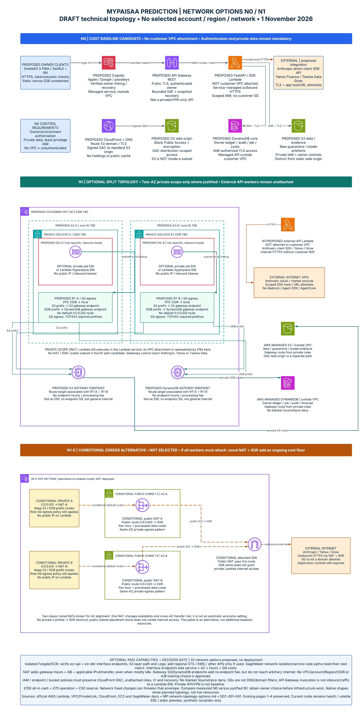

# Architecture

## Scope

The first production release serves one authenticated owner. It aggregates licensed market data and portfolio records, runs reproducible research/prediction jobs, presents the resulting evidence in web and native mobile clients, and records what happened after every forecast horizon. It is not a brokerage or execution system.

**Status: planned architecture with a runnable backend starter.** As of **1 November 2026**, health and a local sample SSE stream exist, alongside an illustrative static preview. Authentication, persistence, providers, quantitative/research jobs, PWA/native clients and production infrastructure remain pending. The [implementation status](implementation-plan.md#current-implementation-status) and [technology inventory](tech-stack.md) record this boundary.

**Current direction, still draft:** the expanded standalone app includes its own ledger/imports/rules/XIRR, ML forecasts and LLM-derived factors/research. [DEC-001–041](planning/aws-options-2026-11-01/product-decisions.json) supersede earlier conflicting proposals; full end-to-end requirements and UX agreement still gate application implementation. DEC-041 allows synthetic local/dev fixture preparation now, with actual holdings/screenshots/PDFs later and no AWS loading. Lambda/S3/DynamoDB are preferred, direct Anthropic client SDK replaces Agent SDK, Yahoo Finance + Twelve Data Grow are selected, and £100 all-in replaces the earlier £50 AWS-only envelope. ML execution A/B and the detailed deployment design remain unselected. Accepted bootstrap ADR status is preserved pending explicit reconciliation.

Current draft navigation: [pack index](planning/layered-development-2026-11-01/README.md) · [portfolio/import specification](planning/layered-development-2026-11-01/portfolio-import-spec.md) · [PH-00–PH-09 delivery plan](planning/layered-development-2026-11-01/phased-delivery-plan.md) · [architecture blueprint](planning/layered-development-2026-11-01/architecture-blueprint.md) · [technology matrix](planning/layered-development-2026-11-01/tech-stack-matrix.md). The blueprint carries detailed trust boundaries, workflow/persistence/streaming alternatives, readiness gates and the ADR backlog; the material below retains the earlier visual evidence with current-direction corrections. This local alignment remains **unreviewed** and does not update Confluence or run a formal plan-sync.

## Contents

- [System boundaries and visual guides](#visual-guides)
- [Logical components](#logical-components)
- [Data flow](#data-flow)
- [Core records](#core-records)
- [API and event contract](#api-and-event-contract)
- [Research-agent boundaries](#research-agent-boundaries)
- [Mobile division of responsibility](#mobile-division-of-responsibility)
- [Proposed AWS deployment](#proposed-aws-deployment)
- [Security and privacy baseline](#security-and-privacy-baseline)
- [Delivery, evidence and known gaps](#delivery-evidence-and-known-gaps)

## Visual guides

The retained native Lucid system drawing is the editable **bootstrap** source for component and trust boundaries. It predates the complete expanded serverless/import/cost requirements and is not a verified diagram of the current blueprint. Its labels distinguish the starter from planned services; arrows show intended communication, not live telemetry.

[Edit the system Lucidchart](https://lucid.app/lucidchart/3ac220d1-225e-43ea-ac44-361d0c369e69/edit). The saved animation below is an explanatory companion, not a live synchronised Lucid document.

[Static system companion](diagrams/system-architecture.png) · [Text fallback](../README.md#architecture-at-a-glance) · [Sources and motion alternatives](diagrams/README.md). GIFs loop; use the static exports when needed. Blue identifies clients, teal API/records, amber data, purple quantitative work, rose research/consent and navy operations; the labels explain every role without depending on colour.

The later [editable A/B planning Lucidchart](https://lucid.app/lucidchart/02218133-613a-4b78-aea4-e0dba26db386/edit), [Plan A native export](planning/aws-options-2026-11-01/option-a-lucid.png) and [Plan B native export](planning/aws-options-2026-11-01/option-b-lucid.png) show the active alternatives; Plan C is retired. These prior exports are manually maintained and need an approved update for all new blueprint details. No external diagram write or new paid feature was performed here.

## Logical components

These are current intended responsibilities; exact adapters, schemas and service topology remain proposed. See the [current implementation status](implementation-plan.md#current-implementation-status) for what exists today and the [full matrix](planning/layered-development-2026-11-01/tech-stack-matrix.md) for alternatives and costs.

| Component | Responsibility | Planned initial technology |
| --- | --- | --- |
| API | Authenticated commands, read models, bounded SSE, schema validation and job admission | Modular FastAPI codebase on Lambda; streaming adapter/integration proof required |
| Ingestion | Provider normalisation, quality checks, idempotent writes | scheduled Python jobs |
| Research/chat | Cited retrieval, structured factor extraction, specialist evidence and contextual conversation | Official Anthropic client SDK with explicit bounded tool loop on Lambda; Claude runs on Anthropic |
| Quant engine | feature creation, training, validation, calibration, scoring | Python, scikit-learn-compatible pipelines |
| Ledger | Own transactions, holdings, cash, all v1 imports, rules/XIRR, reconciliation | Storage-neutral contracts; DynamoDB preferred subject to atomicity/access-pattern proof; earlier PostgreSQL ADR awaiting reconciliation |
| Prediction registry | Immutable forecast, model, data cutoff, mature outcome and approval records | Durable append-only records plus private artefacts; exact schema/store decision open |
| Web | Discovery first, separate holdings, chat, proof and launch costs | SvelteKit 3, officially available but not installed; static shell versus SSR open |
| Mobile | native device experience and shared navigation contracts | Swift-native surfaces in React Native shell |
| Identity | Managed sign-in and verified owner linking/recovery | Cognito with Apple/Google/passkeys; two independent passkey paths and sensitive-action design required |
| Operations/costs | Audit, per-environment usage/billing, durable jobs, telemetry, recovery | AWS serverless preference; launch cost/admission controls; workflow and full-scope pricing open |

## Data flow

1. An ingestion schedule fetches only permitted provider data. It validates the payload, maps provider symbols to internal instruments, records timestamps and quality flags, then writes immutable raw/canonical records.
2. A feature job declares a data cutoff and emits a versioned feature set. It may only use observations available before that cutoff.
3. A training job runs temporal folds. Each fold learns all preprocessing exclusively from that fold’s training window. It stores metrics, calibration, baselines, feature definition, code revision, dataset hash, and artefact reference.
4. A publishing job may create a forecast only from an approved model run. It saves target, direction/return distribution, horizon, confidence, uncertainty, as-of timestamp, evidence, and explanation.
5. When the horizon passes, the outcome job loads the canonical realised value, creates an immutable outcome record, and updates aggregate dashboards. It never rewrites the original forecast.
6. The API publishes a small SSE notification such as prediction-published or outcome-scored. Clients fetch durable state through normal authenticated API reads.

Imports follow a separate confirmed-preview-to-commit flow: CSV, Excel, PDF/statements, screenshots or manual input → validated/quarantined source → versioned extraction/draft → owner confirmation → bounded durable commit/reversal and audit. Uncertain extraction requires review. Financial commit visibility, application idempotency, outbox and large-import staging are explicit design/proof gates; S3 and a database do not form one distributed transaction. See the [detailed import contracts](planning/layered-development-2026-11-01/portfolio-import-spec.md).

The lifecycle animation makes the scientific order explicit: declare a cutoff, fit preprocessing only inside each training fold, compare benchmarks, append a forecast, wait for maturity and append its outcome. Research agents supply cited evidence and cannot publish or alter forecasts.

[Static lifecycle](diagrams/prediction-lifecycle.png) · [Editable supporting Draw.io source](diagrams/prediction-lifecycle.drawio)

## Core records

| Record | Minimum fields |
| --- | --- |
| Instrument | internal ID, asset class, provider symbols, exchange, currency, active state |
| Market observation | instrument ID, provider, source time, received time, interval, OHLCV/value, quality flags |
| Portfolio transaction | immutable ID, account/import batch, instrument, quantity, price, fees, currency, trade/settle time, source |
| Feature set | version, data cutoff, definition hash, asset universe, storage reference |
| Model run | version, training cutoff, feature set, fold definitions, parameters, metrics, calibration, artefact hash |
| Prediction | ID, model run, instrument, as-of, explicit data cutoff, target, horizon, forecast distribution/probability, confidence/calibration, uncertainty, explanation/evidence references, status, version/supersedes linkage |
| Outcome | prediction ID, realised value/time, scoring method, metrics, outcome version |
| Research item | source URL, publisher/date, retrieval time, extracted claims, citations, agent run ID |
| Upload/import | document/object version/hash, row/page evidence, extractor version, preview hash/confirmation, commit/reversal and audit references |
| Job/audit/approval | owner/environment, stable business/run IDs, attempts/lease/terminal state, config/build versions and owner action evidence |
| Cost reservation/report | logical request ID, environment/feature/agent/model, reserved/actual/ambiguous liability, price/FX version, provider covered-through/reconciliation state |

## API and event contract

All external API routes start with /api/v1. The planned initial read/write surface is deliberately small:

| Route family | Purpose |
| --- | --- |
| health | liveness and non-sensitive dependency status |
| instruments | searchable canonical asset catalogue |
| prices | timestamped history and provider freshness metadata |
| portfolio/imports | CSV/Excel/PDF/screenshots/manual preview/confirmation/commit/reversal, ledger, holdings and reconciliation warnings |
| research | source-backed briefings and retrieval status |
| predictions | current forecasts, historical forecasts, outcome metrics, model provenance |
| conversations/jobs | Contextual chat, typed task state, safe retries and owner confirmations |
| costs/audit/settings | Cached per-environment cost views, traceable activity and protected owner controls |
| stream | authenticated server-sent events |

SSE messages contain an event ID, type, occurred-at time, and a resource reference. They do not include credentials, account holdings, raw provider payloads, or model artefacts. Heartbeats detect dead connections. Clients reconnect with the last event ID and then re-fetch their read model so an ephemeral event never becomes a source of truth.

The new blueprint additionally allows bounded provisional chat deltas until the final message is durable. Exact payload/privacy schemas remain to agree. In AWS, API Gateway response streaming requires a REST proxy integration in `STREAM` mode, not an assumed HTTP API path; Python Lambda needs a compatible streaming adapter/custom runtime. Streams are bounded and authenticated, with cursor-gap snapshot recovery. Accepted jobs survive disconnects, and reconnects never repeat paid calls or ledger mutations. The [blueprint's streaming section](planning/layered-development-2026-11-01/architecture-blueprint.md#api-and-sse-bounded-transport-durable-work) links current primary documentation and unresolved compatibility/cost evidence.

**Starter limitation:** the current stream has no authentication or durable replay and uses volatile in-process IDs/queues. Allowing a `Last-Event-ID` header in CORS does not implement resumption. Authentication, reconnection tests and recovery by re-fetching durable records must be added before production. The contract above describes the required behaviour, not a completed implementation.

## Research-agent boundaries

Specialist agents provide source-backed synthesis and versioned structured factors under application-controlled authority. The table is illustrative; exact manifests remain proposed:

| Specialist | Allowed work | Explicitly forbidden |
| --- | --- | --- |
| Market context | Summarise macro/calendar releases and classify cited events | Publish unapproved numerical forecasts or place orders |
| Company research | extract filings/news claims with citations | invent sources or alter forecasts |
| Risk reviewer | identify data staleness, concentration and contradictory evidence | override ledger records |
| Evaluation analyst | explain validation/outcome dashboards | retrain or publish without a gated job |

Each agent receives a narrow task, allowlisted tools, time/token/iteration budget and structured schema. The official Anthropic client SDK is the target, with an explicit server-controlled loop; the old optional Agent SDK dependency does not implement it. Retrieval/tool/model text is untrusted. Persist provenance, evidence references, guardrail/evaluation outcomes, costs and review state; minimise/redact sensitive content rather than copying every prompt/source into general logs. T0/T1/T2 and online answer-quality evaluations remain distinct from numerical walk-forward calibration and mature outcomes. Owners approve model promotion; agents cannot alter the ledger, grant themselves tools, raise budgets or trade.

## Mobile division of responsibility

The Swift layer is the native iOS/iPadOS product: SwiftUI screens, Keychain access, offline cache, widgets, notifications, and large-screen layouts. The React Native shell provides shared navigation, bridge contracts, release coordination, and a path for future non-Apple clients. Feature teams should prefer a native Swift implementation for data-rich iOS/iPadOS screens and expose only stable, typed bridge interfaces.

The precise iPhone/iPad/“Duo” device/OS matrix, bridge versions and secure offline/push behaviour remain to agree. Native drawings and requirements do not demonstrate an installed Swift or RN product.

## Proposed AWS deployment

**Current direction:** Lambda/S3/DynamoDB preferred, with CloudFront/Route 53/API Gateway and Cognito; full topology remains draft. Option A portable ML jobs versus B selective SageMaker jobs is unselected, with no continuously provisioned endpoint assumed. Workflow choice (Durable Functions versus Step Functions), region, identity tier, data-store fit and stream fan-out require evidence and an ADR. Private dev/prod authority, audit and cost foundations precede ledger implementation; synthetic dev packs remain prepared locally until cloud loading is separately authorised.

**Historical accepted bootstrap footprint, retained for traceability:**

[Edit the AWS Lucidchart](https://lucid.app/lucidchart/f9a80493-7f58-44c1-b201-e97034a1398c/edit) · [Animated deployment companion](diagrams/aws-deployment.gif)

The original accepted ADR proposed a reverse proxy, API, scheduled worker and PostgreSQL on one small Lightsail host, with encrypted S3 backups and bounded CloudWatch. Its single-host availability assumptions and diagram are not the chosen expanded architecture. ADR status has not been silently rewritten; the new [ADR backlog](planning/layered-development-2026-11-01/architecture-blueprint.md#8-readiness-adrs-and-phase-alignment) identifies reconciliation. No executable IaC or deployed resources are claimed.

The earlier [£50 AWS-only model](cost-model.md) is historical. Current confirmed planning is **£100 all-in**, **£70 operation + £30 reserve**, with forecast cash alerts/reductions/optional-job pauses at **£60/£75/£85**. Full-scope cost is unverified; the shared user-reported $200 Anthropic credit is not verified funding or a per-environment allowance. No automatic paid fallback is approved. Launch dashboard costs distinguish live internal estimates from cached Anthropic reports collected 6-hourly and AWS daily. Reservations, reports and parent/child allocations must reconcile without duplicate charges. Budget alerts are not an instant universal AWS billing stop. [Current cost model](planning/aws-options-2026-11-01/cost-model.json) · [Detailed cost/audit requirements](planning/aws-options-2026-11-01/audit-observability-requirements.md).

## Security and privacy baseline

- Authenticate every non-health API endpoint; use device-bound/passkey-capable authentication where possible.
- Store passwords/tokens only in a suitable identity layer or iOS Keychain, never in the web bundle or git.
- Encrypt storage/backups, keep S3 origins/evidence private, and scope per-environment function/store/queue authority. A future persistent-host exception needs its own network/admin-access decision.
- Rate-limit login and expensive research/model endpoints. Apply CSRF controls to cookie-based web sessions.
- Redact secrets, portfolio values, and provider responses from application logs.
- Validate every import method in quarantine before review/commit; retain protected source/version/hash and diagnostics under the agreed deletion policy.
- Document provider licences and retention/use limits before enabling an asset class.
- Separate renewable 24-month original archives from operational logs (14 days), rich traces (30 days), run summaries (90 days) and durable financial/forecast/approval audit. No automatic original deletion or irreversible lock is authorised; define versions/derived/backup deletion and recovery semantics.

## Delivery, evidence and known gaps

The runnable checks cover backend, Codex tooling, the static preview, workflow syntax and Jira PR metadata. There are no executable PWA, Swift or React Native manifests yet, so no corresponding build, accessibility or device-test pass is claimed. [GitHub workflow](github-workflow.md) documents the five check names and the current lack of server-side branch protection. CI does not deploy or approve independent review.

The [PH-00–PH-09 draft](planning/layered-development-2026-11-01/phased-delivery-plan.md) refines the older [MP-4 through MP-9 roadmap](implementation-plan.md#manual-roadmap-links). Full requirements/UX agreement gates implementation; PH-01 ledger/import planning can precede PH-02 platform planning, but ledger implementation depends on PH-02. MP-10–MP-13 remain named foundation references; dated issue statuses in older docs are not freshly verified here. MP-15 holds the current requirements work. Provider rights, identity/recovery, persistence, full-scope cost, exact layouts/devices and restore procedures remain evidence gates. No screen approval or measured predictive result is implied by these drawings.

The [published Confluence architecture](https://duttaarun2015.atlassian.net/wiki/spaces/mypaisaapr/pages/5145394) and [roadmap](https://duttaarun2015.atlassian.net/wiki/spaces/mypaisaapr/pages/5112476) are manually maintained snapshots. Repository docs/ADRs hold versioned technical decisions; Jira holds work status. The [dated sync record](plan-sync-2026-11-01.md) records evidence and remaining delivery steps. No comprehensive automatic planning or diagram-drift gate exists.

## Evolution point

A modular application codebase remains useful while Lambda/job boundaries separate bounded execution and authority. Service count follows evidence, reliability and total cost rather than an assumption that either one host or many services is already chosen. The full blueprint makes async continuations, immutable state, owner approval and the per-layer audit/cost/security gates explicit. Monthly focused recovery and audit-integrity exercises are required; RPO/RTO and complete restore scenarios remain to agree.

## Detailed current MP diagram (proposed)

The new native Lucidchart page 4 documents the current proposed logical system, including import/ledger approval boundaries, bounded agents, controlled learning and per-environment cost visibility. It does not select the remaining architecture alternatives or represent a deployed system.

[Editable Lucidchart](https://lucid.app/lucidchart/02218133-613a-4b78-aea4-e0dba26db386/edit) · [Native-export provenance](planning/layered-development-2026-11-01/visuals/architecture-lucid-manifest.json) · [Static import workflow](planning/layered-development-2026-11-01/visuals/import-workflow.png) · [Opt-in workflow animation](planning/layered-development-2026-11-01/visuals/import-workflow.gif).

## Detailed VPC and network options (unselected)

[Technical network appendix](planning/layered-development-2026-11-01/network-topology-options.md) compares N0 customer-VPC-unattached Lambda, optional N1 isolated jobs across two AZs with gateway endpoints, and conditional NAT/public egress. Subnets, route tables, ENIs, security groups, endpoint policies, managed-service boundaries and cost consequences are explicit. These are unselected planning options; no VPC or other resource is provisioned.

[Native Lucid page-5 evidence](planning/layered-development-2026-11-01/visuals/network-lucid-manifest.json) · [MP alignment proposal](planning/layered-development-2026-11-01/mp-sync-write-proposal.md).
