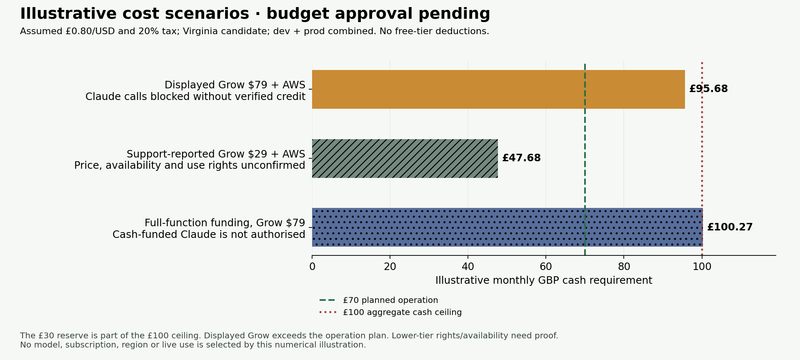

# Foundation Specification Pack 1

**2 November 2026 · MP-20 · Proposed specifications · Unreviewed · Architecture/UX/build unapproved**

This pack turns the selected architecture directions into precise data, financial and forecast contracts with worked examples, planned acceptance and quantitative cost assumptions. It is a local maker draft. It implements no application feature and runs no live acquisition, model, training, backtest, AWS account or deployment operation.

## Read the specification

| Read next | What it defines |
| --- | --- |
| [Integration specification](integration-specification.md) | Producer/consumer handoffs, units, clocks, price bases, financial truth, eligibility and funding boundaries |
| [Data/source specification](data/specification.md) | Real listing identities, source capabilities, per-use rights, timestamps/revisions, quotas and acquisition lifecycle |
| [Financial specification](financial/specification.md) | Controlled ledger/import publication, financial formulas, corrections, FX, benchmark, risk and ranking semantics |
| [Forecasting specification](forecasting/forecasting-specification.md) | Tasks/labels, seven horizons, model/feature ladder, chronology, calibration, evidence and promotion |
| [Cost specification](costs/specification.md) | Per-unit public prices, workload assumptions, regional scenarios, shared credits and the budget feasibility gate |
| [Policy and evidence register](policy-evidence-register.md) | Confirmed answers, proposed policy bundles and external/live evidence that remain open |
| [Coverage and deliverables](coverage.json) | Source-gap/task joins, artifact roles and actual-versus-planned verification |

Every area has structured JSON contracts/catalogues, synthetic examples, acceptance definitions, primary-source research and maker-check receipts. JSON Schema shape validation is not evidence that a future backend enforces the full cross-record policy.

[Fixed owner-policy snapshot](fixed-policies.json) resolves later decisions over earlier embedded pending values, including **AWS billing daily and Anthropic billing every six hours**. These are collection schedules; delayed billing is not credit-allocation proof.

## Owner-confirmed horizon detail

[Owner receipts](owner-decisions.json) add two decisions to the twelve source directions:

- **FND-DEC-001:** next day plus **5, 10 and 20 trading-day** formal points; retain 3/6/12-month forecasts and separate 3–5-year scenarios.
- **FND-DEC-002:** **calendar-month anniversaries**, rolled to the preceding valid local session/valuation date if closed. Score only once the canonical target-date value is available.

Exact daily cutoff/finality tolerances, calendar invalid-day conventions, financial precision, model/event thresholds, qualification policies and scenario assumptions remain explicit proposals. The confirmed 30-minute monitoring cadence is distinct from daily formal forecasts.

## Budget feasibility remains conditional

The [model](costs/model.json) includes both AWS environments with no free-tier deductions and separates allowable blocked-Claude mode from counterfactual cash-funded full functionality. Under its **assumed £0.80/USD and 20% tax** central scenario, the displayed Grow $79 option plus the Virginia AWS candidate is approximately **£95.68/month even with Claude calls blocked**, above the £70 planned-operation allowance. Full cash-funded Claude would require approximately £100.27 and is not authorised.

A support-reported $29/55-credit Grow candidate produces approximately £47.68 in the same blocked-Claude scenario, but current purchase terms, rights and coverage are unverified. Neither is an approved bill, regional selection or proven complete-system fit. The global £100 cash ceiling and £30 reserve remain unchanged. [Scenario source/evidence](costs/research.json).



[Vector chart](costs/cost-scenarios.svg) · No credit assumed available · Model calls require separately verified coverage and approved policy.

## Source and branch boundary

PR #9 remains open and untouched at `34b03900837428b51ddffcd637d92c1cd2a6fb1e`. Its twelve decisions and published planning-draft pages are references, not authority to start UX/build. [Source pins](source-pins.json) and [selected-direction snapshot](selected-directions.json) identify exactly what this work used.

This separate `MP-20-foundation-specifications` branch starts at `origin/main` commit `68ad1bf`; it does not merge or cherry-pick PR #9 or change its head. Only this new planning folder and its own review bookkeeping are authored here. Source root navigation updates are [prepared separately](navigation-change-proposal.md) for integration after the checkpoint dependency is reconciled. Current owner instructions and the selected directions supersede historical £50/local-PostgreSQL/Agent-SDK assumptions still present in the base checkout.

MP-20 coordinates the pack. Existing MP-10/12/21/22/24/29 are reused and In Progress; this pack does not close their full acceptance or the 52 source gaps. Actual owner holdings and PDFs/screenshots remain deferred; examples use real instrument identities with explicitly simulated observations and fictional accounts.

## Verification and authority

Run:

```
uv run --no-project --with jsonschema==4.25.1 python docs/planning/foundation-specifications-2026-11-02/validate.py
```

The offline command requires the pinned PR #9 Git object from the reference history; a fresh shallow checkout must obtain that authorised reference separately. The checker itself performs no network fetch.

The [validation receipt](validation.json) records document/schema/math/provenance checks. It covers 34 positive wire records, strict negative format/scalar cases, 15 financial plus 15 scientific worked examples, 108 cash variants and source/reference consistency. The 73 area acceptance cases are **planned backend/live tests**, not 71 executed integration tests. [Maker verification](MAKER-CHECKS.md).

Independent review and the real MP-20 regression ledger have not run. No new Confluence page, Site, Lucid document or PR is published by this draft. A [five-page reading/publication proposal](publication-proposal.json) is prepared locally for a separately approved scope. Full architecture/phase/story sign-off precedes UX; complete end-to-end/admin UX and explicit permission precede implementation.
