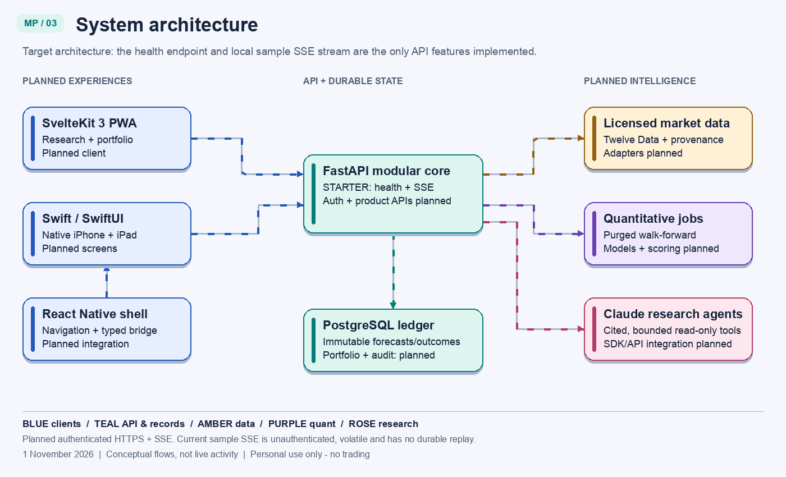
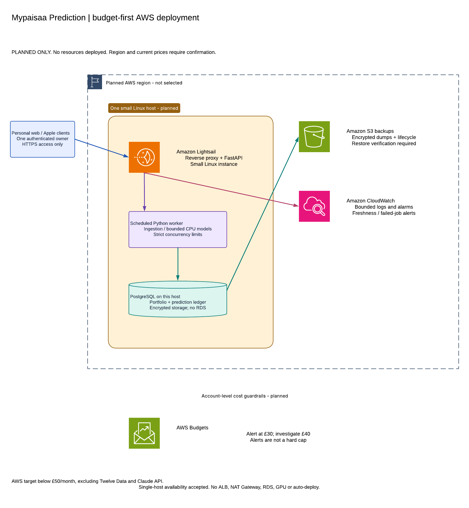
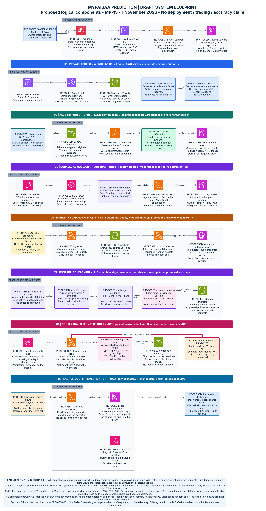
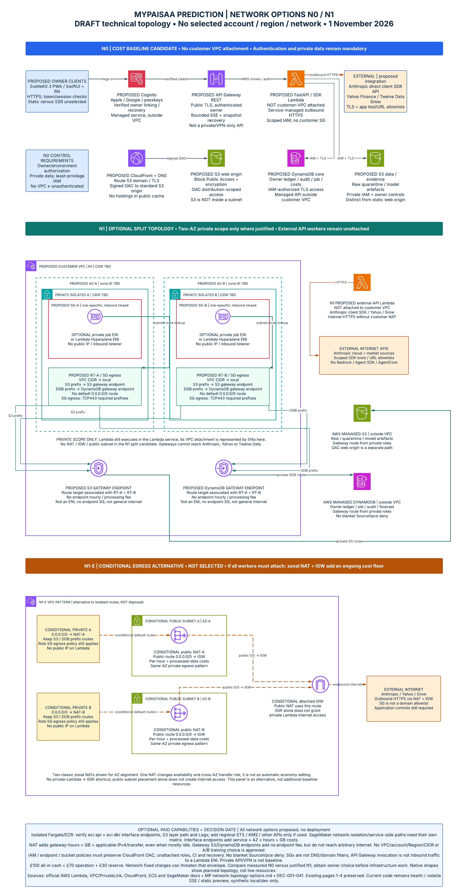

# Technology stack

**Current selection work, 2 November 2026:** [MP-19 research and decision cards](planning/ma-reconciliation-2026-11-02/decision-cards.md) assess MA concepts for this separate app, including workflow/runtime, ML training versus serving, identity/action assurance, source rights, telemetry/eval costs and client compatibility. Exact versions, topology and region require MP evidence and owner decisions; MA version/free-tier claims are not imported. [Reconciliation and gap register](planning/ma-reconciliation-2026-11-02/README.md). Architecture and the detailed phase/story baseline must be agreed before UX; no application implementation is authorised.

**Snapshot: 1 November 2026 · Backend starter implemented · Product clients and production services planned**

This inventory separates technology choices from working features. A package in `uv.lock` proves a resolved dependency version, not an implemented product capability or a completed compatibility test. [Architecture](architecture.md) explains the boundaries; [implementation status](implementation-plan.md#current-implementation-status) names what remains unbuilt.

**Current planning authority:** [DEC-001–041](planning/aws-options-2026-11-01/product-decisions.json) and the [layered pack](planning/layered-development-2026-11-01/README.md). DEC-041 permits synthetic local/dev fixture preparation now; actual holdings/PDFs/screenshots arrive later and AWS loading is deferred. End-to-end requirements and UX agreement still gate application implementation. The target uses the official Anthropic **client SDK**, an explicit bounded loop on Lambda and direct Anthropic hosting, alongside selected Yahoo Finance + Twelve Data Grow. Lambda/S3/DynamoDB are preferred; detailed architecture/ML A/B remains unselected. Accepted bootstrap ADRs and old lock entries are preserved as evidence pending reconciliation.

Current draft navigation: [portfolio/import specification](planning/layered-development-2026-11-01/portfolio-import-spec.md) · [PH-00–PH-09 delivery plan](planning/layered-development-2026-11-01/phased-delivery-plan.md) · [architecture blueprint](planning/layered-development-2026-11-01/architecture-blueprint.md) · [full technology matrix](planning/layered-development-2026-11-01/tech-stack-matrix.md). The matrix details responsibilities, interfaces, alternatives, status and cost impact; the snapshot below retains verified starter versions. This local documentation alignment remains **draft and unreviewed**, without external publication or automatic plan-sync.

## Stack in context

The retained bootstrap animated companion shows the intended relationship between clients, API, licensed data, scientific evaluation, bounded research and immutable records. It predates the complete expanded import/serverless/cost requirements and is not a verified drawing of the new blueprint. It explains direction and sequence; it is not live telemetry, deployed infrastructure or a performance claim.

[Static system companion](diagrams/system-architecture.png) · [Bootstrap system Lucidchart](https://lucid.app/lucidchart/3ac220d1-225e-43ea-ac44-361d0c369e69/edit) · [Diagram sources and legend](diagrams/README.md). GIFs loop; use the static image if motion is distracting. Blue identifies clients, teal API/records, amber data, purple quantitative work, rose research/consent and navy operations; labels carry those meanings without colour alone.

[Current A/B planning Lucidchart](https://lucid.app/lucidchart/02218133-613a-4b78-aea4-e0dba26db386/edit) · [Plan A native export](planning/aws-options-2026-11-01/option-a-lucid.png) · [Plan B native export](planning/aws-options-2026-11-01/option-b-lucid.png). A/B remain unselected and C is retired. Existing A/B/C pages were preserved; new detailed pages 4 and 5 were added under explicit diagram-authoring authority, with native export evidence below. These remain proposed diagrams, not deployed resources.

## Components and version evidence

Versions below come from this repository's [backend manifest](../backend/pyproject.toml), [dependency lock](../backend/uv.lock) and [CI definition](../.github/workflows/verify.yml). They are not a claim that these are the latest available releases. No new provider or Claude call was made to prepare this inventory.

| Component | Technology/direction | Implemented status | Version evidence |
| --- | --- | --- | --- |
| Backend language | Python | Runnable starter; project requires Python 3.12+ | `requires-python = ">=3.12"`; CI selects Python 3.12 |
| HTTP API | FastAPI | Health and sample SSE route registration exist; product APIs pending | FastAPI **0.162.0** resolved in `backend/uv.lock` |
| Configuration | Pydantic Settings | Environment-backed starter settings | `pydantic-settings` **2.16.2** locked |
| ASGI server | Uvicorn | Local development entry point documented | Uvicorn **0.54.0** locked |
| Server-sent events | `sse-starlette` | Sample stream and heartbeat code; authentication and durable recovery pending | `sse-starlette` **2.4.1** locked |
| Dependency management | uv | Frozen backend installation and lock checks in CI | CI pins **uv 0.12.9** |
| Backend tests and lint | pytest, Ruff | Starter suites/configuration and CI exist | pytest **8.4.2**, Ruff **0.17.3** locked; a lock entry is not a fresh test result |
| Durable records | DynamoDB selected in ARC-02; PostgreSQL in historical baseline | No persistence implementation; ledger access/atomicity proof and exact schema design pending | No selected server/store SDK version or production instance implied |
| Historical database dependencies | SQLAlchemy, asyncpg, Alembic | Optional `data` group retained; not an implemented or selected target ledger | SQLAlchemy **2.1.6**, asyncpg **0.32.0**, Alembic **1.20.1** locked as optional dependencies |
| Quantitative pipeline | NumPy, pandas, scikit-learn-compatible estimators | Optional `ml` group; feature, evaluation, calibration and scoring code pending | NumPy **2.5.4**, pandas **2.3.3**, scikit-learn **1.9.1** locked; scientific validity not established by versions |
| Research runtime target | Official Anthropic client SDK; explicit bounded tool loop on Lambda | Not implemented; direct calls to Claude on Anthropic, not Bedrock/AgentCore/Agent SDK | Exact client/model/API versions require selection and compatibility evidence |
| Historical agent dependency | Claude Agent SDK | Old optional `agents` group retained pending authorised reconciliation; not the current target | `claude-agent-sdk` **0.2.176** locked; a lock entry does not implement the selected research runtime |
| Selected market-data pair | Yahoo Finance + Twelve Data Grow | No adapter enabled; per-listing roles, coverage and actual tier require evidence | Rights, UK/US/India listings, history, freshness and quota checks before live activation |
| Product web app | SvelteKit 3 PWA | Planned; `web/` has no executable app manifest | SvelteKit **3 is officially available**, not installed here; exact package/Node/Vite/adapter set open |
| Apple feature UI | Swift / SwiftUI, iOS and iPadOS | Planned native product screens, cache and device integrations | No `Package.swift` or executable native project; Swift/Xcode/deployment versions not selected |
| Mobile shell | React Native | Planned navigation and typed Swift bridge | No executable shell manifest; React Native version and bridge compatibility not selected |
| Static concept preview | Buildless HTML/CSS | Illustrative `site/dist/index.html` exists; not the product PWA | No JavaScript application framework version implied |
| Compute/workflows/IaC | Lambda Durable Functions with Python selected in ARC-03; CDK/CloudFormation choice open | Placeholder infrastructure only; bootstrap small-host design is historical | No executable IaC, image, adapter or deployment claimed; Python 3.12 starter compatibility is not proof for every workflow |
| Hosting and evidence | CloudFront/Route 53/API Gateway, private S3; DynamoDB preferred | Serverless direction proposed; region/identity/streaming/schema/cost gates open | No resources provisioned; no continuously provisioned ML endpoint assumed |
| ML execution | A portable bounded jobs or B selective SageMaker; MP-18 diagrams depict B on request | Execution choice still unselected; proposed B uses short-lived CPU training/evaluation and approved portable inference | Two proposed initial trainable families (F3 and F5); no endpoint, model ID or SageMaker job is installed/provisioned; full-scope cost and runtime measurements required |
| Identity | Cognito managed Apple/Google/passkeys | Not implemented; verified owner linking plus two independent recovery paths required | Tier/session/reauthentication/device compatibility need proof |
| Monitoring and costs | Launch app cost/audit views; telemetry/collector/admission tooling under evaluation | No collectors, alarms, reservations or spend dashboard implemented | Live estimates plus Anthropic reports every 6 hours/AWS daily; gross usage/credits/cash and shared costs separate |
| Delivery | GitHub Actions, issue branches and PRs to `main` | Backend/tooling/preview/workflow/Jira-metadata checks configured | Action revisions and tool pins live in `.github/workflows/`; server-side protection remains unavailable under the current GitHub plan |
| Architecture sources | Lucidchart; Draw.io supporting workflows/animation companions | Editable architecture documents and saved exports exist | Source IDs and snapshot hashes in [diagram manifest](diagrams/manifest.json); manual refresh only |

The [MP-18 deep dive](architecture-deep-dive.md) documents EventBridge Scheduler versus optional bus, separate SQS work/target/worker DLQs, direct Anthropic SDK live Sonnet and deferred Haiku Message Batches, two proposed SageMaker ML families, and CloudWatch/X-Ray/CloudTrail/billing collection. Its [native Lucid pages 6–8](diagrams/aws-e2e-2026-11-01/manifest.json) are dated planning evidence. The exact Anthropic model IDs, SageMaker inference path, orchestration choice, region and cost viability remain open; the older Agent SDK/£50 bootstrap fields below are retained as historical evidence.

The current technical page is [published in MP Confluence](https://duttaarun2015.atlassian.net/wiki/spaces/mypaisaapr/pages/4981639); native attachments and the three parent-hub links are recorded in the [sync receipt](diagrams/aws-e2e-2026-11-01/confluence-sync.json).

## Proposed runtime footprint

The [new blueprint](planning/layered-development-2026-11-01/architecture-blueprint.md) proposes the serverless boundaries and open choices. The native Lucidchart export below preserves the **historical accepted bootstrap** footprint: one small host for reverse proxy, API, scheduled worker and PostgreSQL, encrypted S3 backups and bounded monitoring. It is not the selected expanded runtime. Accepted ADR status has not been rewritten and all production infrastructure remains unimplemented.

[Edit the historical AWS Lucidchart](https://lucid.app/lucidchart/f9a80493-7f58-44c1-b201-e97034a1398c/edit) · [Animated deployment companion](diagrams/aws-deployment.gif) · [Historical cost assumptions](cost-model.md)

Current confirmed cash planning is **£100/month all-in**, **£70 operation + £30 reserve**; forecast monthly cash alerts/reduction/optional-job pause thresholds are **£60/£75/£85**. It includes dev/prod AWS, data and Claude/evaluation costs; full-scope pricing remains unverified. The $200 Anthropic organization benefit is user-reported, shared and unverified, with no automatic paid fallback. Cost admission/reservations must handle delayed reports and ambiguous calls without double counting; they are not a universal instant AWS bill cap. The older £50 AWS-only budget/£30–£40 alerts belong to the retained bootstrap model. [Current assumptions](planning/aws-options-2026-11-01/cost-model.json) · [Cost/audit requirements](planning/aws-options-2026-11-01/audit-observability-requirements.md).

## Contracts that govern the choices

- **Personal use, no trading:** no broker execution credentials, order endpoints or agent transaction authority.
- **Durable truth:** portfolio transactions, model runs, predictions, corrections and mature outcomes require append-only records. DynamoDB is selected as the ARC-02 direction, with ledger-fit proof pending; historical PostgreSQL ADRs await reconciliation. The sample event bus is not a database and S3/database writes are not one atomic transaction.
- **Scientific validity:** chronological walk-forward evaluation, appropriate purge/embargo, train-fold-only preprocessing/calibration, declared benchmarks and reproducible provenance are required before claiming predictive performance.
- **Research boundaries:** direct Anthropic client-SDK agents organise cited evidence and versioned structured factors with allowlisted tools and token/time limits. They cannot mutate models/ledger, publish forecasts, trade, increase budgets or access secret values. Agent answer-quality evaluation is separate from numerical predictive evaluation.
- **Transport:** `/api/v1/stream` currently lacks authentication and durable replay. IDs and queues are process-local; accepting `Last-Event-ID` in CORS does not implement resumption. Production clients must reconnect safely and re-fetch durable state.
- **Client split:** Swift owns meaningful iOS/iPadOS screens, cache, secure device integration and accessibility. React Native owns navigation and typed bridge contracts. The web PWA remains a separate planned client over the same authenticated API.
- **Web compatibility:** [SvelteKit 3 is available](https://svelte.dev/blog/sveltekit-3-is-here); [static output](https://svelte.dev/docs/kit/adapter-static) does not run SSR/server routes. Static versus SSR and its adapter/session costs remain open.
- **Cloud streaming:** API Gateway REST `STREAM` plus a compatible Python streaming adapter is a proposed path; HTTP API streaming, durable replay and actual regional compatibility are not assumed. See the primary sources and bounded reconnect contract in the [blueprint](planning/layered-development-2026-11-01/architecture-blueprint.md#api-and-sse-bounded-transport-durable-work).
- **Retention/recovery:** renewable S3 originals (24 months) with owner extension/deletion; operational logs (14 days), rich traces (30 days) and run summaries (90 days); durable ledger/forecast/approval evidence has separate retention. No automatic deletion authorised; monthly focused recovery/audit checks required, with RPO/RTO still open.

## Build and verification boundaries

Current CI covers **Backend, Codex tooling, Static preview, Workflow lint and Jira traceability**. The preview check is structural; it does not certify an operational PWA, browser accessibility or investment functionality. Web, Swift and React Native builds/tests must be added with their first executable manifests. [GitHub delivery and CI](github-workflow.md) records the procedure and existing evidence; this document does not assert a fresh test pass.

The initial planning tasks are [MP-10: data licences and instrument policies](https://duttaarun2015.atlassian.net/browse/MP-10), [MP-11: personal authentication](https://duttaarun2015.atlassian.net/browse/MP-11), [MP-12: persistence schemas](https://duttaarun2015.atlassian.net/browse/MP-12), and [MP-13: backups and restore verification](https://duttaarun2015.atlassian.net/browse/MP-13). The [manual roadmap mapping](implementation-plan.md#manual-roadmap-links) links phases to MP-4 through MP-9.

The current [PH-00–PH-09 plan](planning/layered-development-2026-11-01/phased-delivery-plan.md) refines that earlier mapping. PH-00 gates all implementation on full baseline/UX agreement; PH-01 ledger/import planning can occur now, while its implementation depends on PH-02 foundations. The current requirements work is MP-15. Old Jira status snapshots are not freshly verified by this local alignment.

The [Confluence architecture](https://duttaarun2015.atlassian.net/wiki/spaces/mypaisaapr/pages/5145394) and [development/CI page](https://duttaarun2015.atlassian.net/wiki/spaces/mypaisaapr/pages/5014127) are published snapshots; they were not updated by this work. Local decision registers and accepted ADRs hold versioned decisions and explicit reconciliation gaps; Jira holds work status. External updates require their approved scope and do not happen through automatic bidirectional synchronization. [MP-3](https://duttaarun2015.atlassian.net/browse/MP-3) records the earlier sync; current planning belongs to MP-15, not MA.

## Documentation reference

Document organisation was informed by the user-supplied [Smart-Clearance repository](https://github.com/aibuilder2026/smart-clearance/tree/55676ab4b088713749020678afa1df40cd303f00), read on **1 November 2026** at commit `55676ab4b088713749020678afa1df40cd303f00`: its [README](https://github.com/aibuilder2026/smart-clearance/blob/55676ab4b088713749020678afa1df40cd303f00/README.md), [architecture document](https://github.com/aibuilder2026/smart-clearance/blob/55676ab4b088713749020678afa1df40cd303f00/ARCHITECTURE.md), and [technology-stack document](https://github.com/aibuilder2026/smart-clearance/blob/55676ab4b088713749020678afa1df40cd303f00/docs/smart-clearance-tech-stack.html). The adopted patterns are explicit status, layer/version tables, inline editable-diagram links, operational boundaries and known gaps. This project's technology choices and requirements remain those recorded in its own [knowledge base](knowledge-base.md) and [ADRs](adr).

## Detailed current MP diagram (proposed)

The new native Lucidchart page 4 documents the current proposed logical system, including import/ledger approval boundaries, bounded agents, controlled learning and per-environment cost visibility. It does not select the remaining architecture alternatives or represent a deployed system.

[Editable Lucidchart](https://lucid.app/lucidchart/02218133-613a-4b78-aea4-e0dba26db386/edit) · [Native-export provenance](planning/layered-development-2026-11-01/visuals/architecture-lucid-manifest.json) · [Static import workflow](planning/layered-development-2026-11-01/visuals/import-workflow.png) · [Opt-in workflow animation](planning/layered-development-2026-11-01/visuals/import-workflow.gif).

## Detailed VPC and network options (unselected)

[Technical network appendix](planning/layered-development-2026-11-01/network-topology-options.md) compares N0 customer-VPC-unattached Lambda, optional N1 isolated jobs across two AZs with gateway endpoints, and conditional NAT/public egress. Subnets, route tables, ENIs, security groups, endpoint policies, managed-service boundaries and cost consequences are explicit. These are unselected planning options; no VPC or other resource is provisioned.

[Native Lucid page-5 evidence](planning/layered-development-2026-11-01/visuals/network-lucid-manifest.json) · [MP alignment proposal](planning/layered-development-2026-11-01/mp-sync-write-proposal.md).
